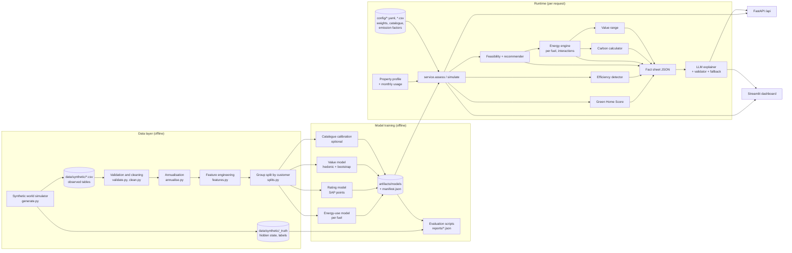
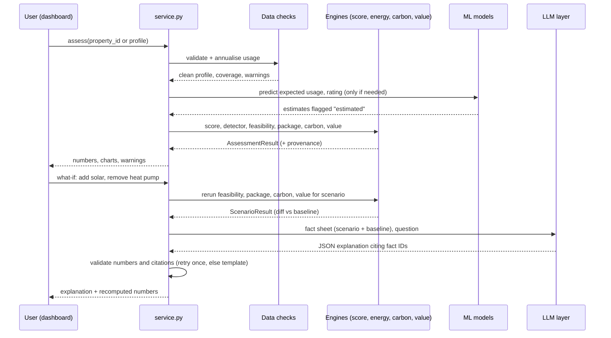
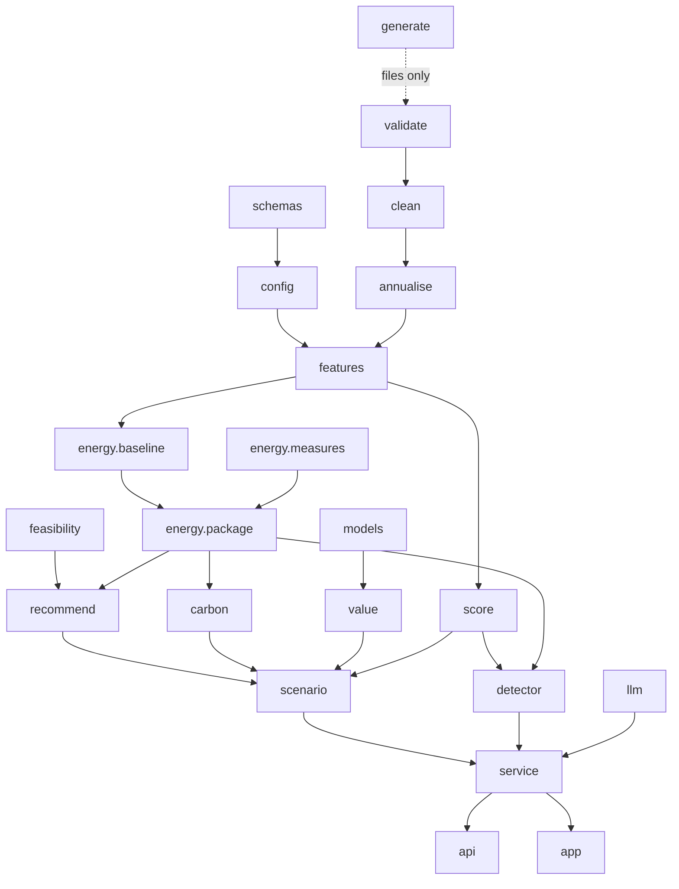

# Green Home Score and Retrofit Engine — Build Specification for an Implementing Agent

Lloyds Problem Statement 2, Megathon X: Singularity
Spec version 1.0 · 10 October 2026 · Repository name: `green-home-engine`

---

## INSTRUCTIONS FOR THE IMPLEMENTING AGENT (read first)

You are receiving this document as your complete brief. Build the whole repository described here: source code, configs, data generator, training and evaluation scripts, API, dashboard, tests and documentation. The official problem statement has already been read and every requirement is captured in Section B with its source reference; you do not need the original PDF.

Rules you must follow:

1. **Follow this spec.** Everything tagged [OFFICIAL] is a hard requirement from the Lloyds brief. [DESIGN] items are decisions already made; keep them unless they cannot work, and if you change one, record why in `docs/ASSUMPTIONS_AND_LIMITATIONS.md`. [ASSUMPTION] values go in config files, never hard-coded in logic.
2. **Models calculate, the LLM explains.** No number shown to a user may be produced by the LLM. Carbon factors and formulas must never appear inside prompts as things for the LLM to compute with.
3. **Never fabricate.** Do not invent metrics, test results, sources or API behaviour. Every metric in a document must be read from a file produced by a script you ran. If a number has not been measured, write "not yet measured".
4. **Missing never means zero.** Missing inputs produce `status` values (`estimated`, `provisional`, `unavailable`, `insufficient_information`), never silent zeros.
5. **Build in the milestone order of Section U.** After each milestone, run its tests and fix failures before moving on. Do not produce one untested code dump.
6. **Reproducibility.** Fixed seeds, pinned dependencies, `make all` regenerates data, models, reports and test predictions from scratch.
7. **Verify before claiming.** At the end, write `docs/BUILD_STATUS.md` listing each requirement ID from Section B as Implemented+Tested / Implemented-untested / Not implemented, with the test IDs that passed.
8. **Environment facts you must check yourself:** installed Python version, whether `pip install` works, whether an LLM API key exists. The app must run fully without an API key (template fallback).
9. Target: a team demo in a 24-hour hackathon. Priority is a working end-to-end MVP (Section A.7) before any optional item (A.9).

Notation used in this spec:

- **[OFFICIAL]** requirement from the brief, with source `PDF p.N §M` (7-page brief) and `S#` (15-slide deck).
- **[DESIGN]** decision made for this build. **[ASSUMPTION]** placeholder value kept in config and listed in Appendix B.
- Worked-example numbers are illustrative and are also used as unit-test fixtures (they have been arithmetic-checked).


---

## Section A — Executive summary and product definition

### A.1 The real-world problem

A.1.1 Many people want a more energy-efficient home but do not know where to start [OFFICIAL, PDF p.1 §1; S2]. They do not know how efficient their home is now, which improvements suit their home, what they would save, or whether the work could add value to the property.

A.1.2 The brief asks for a system that answers four questions [OFFICIAL, PDF p.1 §1; S2]:

1. How green is my home today?
2. What should I improve?
3. How much energy and carbon could I save?
4. Could this increase my property's value?

A.1.3 Lloyds is a bank. A credible answer helps two groups: homeowners deciding what to do, and the bank deciding how to support green home lending and where its customers' homes are least efficient. The second use is our interpretation of "business relevance" [DESIGN]; the brief itself only names customers and properties.

### A.2 Who will use the application

A.2.1 **Homeowner (customer view).** Looks at one property. Wants a score, a plain explanation, a short list of sensible improvements, and honest estimates.

A.2.2 **Portfolio analyst (business view).** Looks at many properties (for example, a lender's book or a landlord with several homes). The brief requires flagging Poor and Very poor homes and ranking properties by improvement potential [OFFICIAL, PDF p.2 §3; S5]. That is naturally a portfolio task, so the business view is part of the MVP.

A.2.3 **Judges and organisers.** They may rerun our code and inspect data, labels, calculations and outputs [OFFICIAL, PDF p.6–7 §11; S13]. Reproducibility is therefore a user requirement, not an afterthought.

### A.3 What the user can do

1. Select or enter a property (type, age, floor area, energy rating, heating, insulation, glazing, solar, controls, region, value) and its monthly electricity and gas usage.
2. See the Green Home Score (0–100), its classification, and the contribution of each of the seven components.
3. See whether the home is flagged as poorly performing, and its key issues.
4. See a prioritised list of feasible retrofits, each with suitability (High/Medium/Low), estimated saving per fuel, and a reason.
5. See savings for each retrofit and for the whole package, separately for electricity and gas, plus carbon reduction.
6. See an indicative property-value impact as a range.
7. Ask what-if questions ("what if I only do insulation and solar?"). The system reruns the calculations and the LLM explains the new results.
8. (Business view) Filter the portfolio to Poor/Very poor homes and rank them by improvement potential.
9. (Optional extension) Record completed retrofits, constraints and responses, and see recommendations adapt.

### A.4 What makes our implementation useful and technically credible

A.4.1 **Models calculate, the LLM explains.** All numbers come from tested Python code. The LLM receives a fact sheet of computed values and must cite them. A validator rejects any explanation that contains a number not in the fact sheet [OFFICIAL core rule, PDF p.1 §1; S3].

A.4.2 **Per-fuel accounting everywhere.** Electricity and gas are tracked separately from the baseline to the final carbon figure. A heat pump that raises electricity use shows a negative electricity saving [OFFICIAL, PDF p.2–3 §5–6; S7–S8].

A.4.3 **Interaction-aware packages.** Measures are applied in sequence to the remaining demand (fabric first, then controls, then heating system, then solar). Package savings are never the sum of stand-alone savings [OFFICIAL, PDF p.2 §5].

A.4.4 **An honest synthetic world.** We generate data with a documented physics-based simulator that contains hidden factors (occupant behaviour, real heat pump performance, installation quality) which our engine cannot see. Our engine uses a simpler, different model. So evaluation measures how well a practical engine recovers the truth from imperfect observed data, rather than checking a formula against itself. We state clearly that this does not prove real-world accuracy [OFFICIAL requirement to disclose, PDF p.4 §9].

A.4.5 **Fail safely.** Missing data produce ranges, "provisional" labels or "insufficient data" results, never silent zeros [OFFICIAL, PDF p.4 §9; PDF p.6 §11].

A.4.6 **Traceability.** Every result carries a provenance block: input hash, config version, model versions, emissions factor set, timestamp.

### A.5 The complete user journey

A.5.1 Homeowner journey:

1. Open dashboard → choose "My home" → pick a sample property or enter details.
2. Data quality panel shows what is measured, estimated or missing.
3. Score card shows `32/100 — Poor` with a contribution bar chart.
4. Key issues list: "Uninsulated cavity walls", "Single glazing", "High energy use per m² compared with similar homes".
5. Recommendations list, in installation order: loft insulation → cavity wall insulation → double glazing → smart thermostat → heat pump → solar PV. Each item shows suitability, electricity and gas saving, and reason.
6. Package summary: net saving, per-fuel changes, carbon reduction, improvement potential.
7. Value panel: "Indicative potential value impact: +1.5% to +4.0% (£355,000 to £364,000). Not guaranteed."
8. What-if tab: untick heat pump, tick solar → numbers update → "Explain" button gives a grounded explanation.

A.5.2 Portfolio journey:

1. Open "Portfolio" page → see score distribution and class counts.
2. Filter to Poor and Very poor → table ranked by improvement potential, with key issues and estimated carbon reduction.
3. Click a property → opens the homeowner view for that property.

### A.6 What the final demonstration will show

1. Portfolio overview and the ranked list of poor homes.
2. One poor home (P10001-style example) end to end: score breakdown, recommendations, per-fuel savings, carbon, value range.
3. The heat pump case where electricity rises and gas falls, shown as a negative electricity saving.
4. A what-if question answered by rerunning the engine, then explained by the LLM, with fact citations visible.
5. A deliberately incomplete and conflicting profile, showing ranges, warnings and "insufficient data" results.
6. The evaluation report: baselines versus our methods on validation data, and LLM groundedness results.
7. (If built) Customer memory changing a recommendation.

### A.7 MVP scope (must be finished)

1. Synthetic data generator with documented rules, fixed seed, injected data-quality problems, and reference labels.
2. Validation, cleaning and annualisation of monthly usage.
3. Green Home Score with the official weights, documented monotonic mappings, contributions, classification and missing-data policy.
4. Poor-home detector with key issues; improvement potential and portfolio ranking.
5. Retrofit catalogue, feasibility rules, suitability rules and interaction-aware ordering.
6. Deterministic per-fuel energy engine (stand-alone, incremental and package savings).
7. Deterministic carbon calculator with documented DESNZ factors.
8. Three ML models with baselines: energy use (per fuel), energy rating, property value.
9. Property-value range with an indicative label.
10. What-if simulation engine.
11. LLM explanation layer with fact sheet, validator and offline template fallback.
12. Streamlit dashboard (homeowner and portfolio views) and a FastAPI service over the same functions.
13. Tests for every official scenario; evaluation report; held-out test predictions; all documents in Section V.

### A.8 Deliberately excluded from the MVP

1. Fuels other than grid electricity and mains gas (oil, LPG, biomass, district heat). The brief's formulas only define electricity and gas [OFFICIAL, PDF p.3 §6]. Homes heated by other fuels return "unsupported fuel — insufficient data".
2. Full SAP or RdSAP calculations. We use a documented rating-based measure and an ML rating model instead.
3. Embodied or lifecycle carbon, financed emissions, battery storage, export income.
4. Real customer data of any kind [OFFICIAL, PDF p.4 §9].
5. Address-level joins of public datasets.
6. Grants, finance products and mortgage pricing.
7. User accounts and authentication.

### A.9 Optional enhancements (only after the MVP is green)

| Priority | Enhancement | Why it helps | Brief link |
|---|---|---|---|
| 1 | Customer memory (SQLite) | Counts towards Innovation (5%) | PDF p.5 §10; S12 |
| 2 | Calibrating catalogue factors from retrofit history | Stronger savings evaluation | PDF p.6 §11 |
| 3 | Bill savings and payback, using verified price-cap rates | Business relevance | not required |
| 4 | Training the rating model on a real EPC sample | Real-data credibility | PDF p.4 §9 (optional datasets) |
| 5 | Region × rating interactions in the value model | Better value ranges | PDF p.3 §7 |
| 6 | LLM intent parser for free-text what-if questions | Better UX | PDF p.3 §8 |

---

## Section B — Official requirement traceability matrix

### B.1 How to use this matrix

B.1.1 Every row is an obligation. "Module" points to a file in Section E. "Test" points to a test ID in Section S. "Status" is updated as we build. At the start all statuses are `Planned`.

B.1.2 Priority: **M** = mandatory (stated as "must", "should" with a required output, or a submission item); **S** = suggested method (the brief uses the word "suggested"); **O** = optional extension.

### B.2 Functional requirements

| ID | Requirement (paraphrased) | Source | Feature | Module | Input data | Expected output | Acceptance test | Pri | Status |
|---|---|---|---|---|---|---|---|---|---|
| R01 | Calculate a Green Home Score from 0 to 100 for each property | PDF p.1 §1–2; S2, S4 | Score engine | `greenhome/score.py` | property + annualised usage | integer 0–100 | T-SC-01 | M | Planned |
| R02 | Score is a weighted sum of seven sub-scores with fixed weights 25/20/15/15/10/10/5 %, written as fractions summing to 1 | PDF p.1 §2; S4 | Weights config | `config/score_weights.yaml`, `score.py` | — | S = Σ w_k s_k | T-SC-02 | M | Planned |
| R03 | Each sub-score is 0–100; mapping is documented; a better state never gives a lower sub-score | PDF p.1 §2 | Monotonic mappings | `config/subscore_mappings.yaml`, `score.py` | property fields | sub-scores in [0,100] | T-SC-03, T-SC-04 | M | Planned |
| R04 | Energy efficiency component reflects the recorded energy rating (or a documented rating-based measure) | PDF p.1 §2 | EE sub-score from band | `score.py` | `energy_rating` | s_EE | T-SC-05 | M | Planned |
| R05 | Consumption intensity reflects annualised metered energy per m² | PDF p.1 §2; S4 | EUI sub-score | `features.py`, `score.py` | monthly usage, floor area | kWh/m²/yr, s_EUI | T-SC-06, T-DQ-04 | M | Planned |
| R06 | If one input affects more than one component, justify it | PDF p.1 §2 | Overlap register | Section I.7 | — | documented justification | T-DOC-01 | M | Planned |
| R07 | Round final score to nearest integer for reporting and classification | PDF p.1 §2 | Rounding rule | `score.py` | — | integer | T-SC-07 | M | Planned |
| R08 | Classification bands: 80–100 Highly efficient, 65–79 Good, 50–64 Moderate, 30–49 Poor, 0–29 Very poor | PDF p.1 §2; S4 | Classifier | `score.py` | rounded score | class label | T-SC-08 | M | Planned |
| R09 | Show why the property received its score, including each component's contribution | PDF p.2 §2 | Contribution breakdown | `score.py`, dashboard | sub-scores | w_k s_k per component | T-SC-09, T-UI-02 | M | Planned |
| R10 | Flag Poor and Very poor homes and list key issues | PDF p.2 §3 | Efficiency detector | `detector.py` | score, features | flag + issues list | T-DT-01, T-DT-02 | M | Planned |
| R11 | Rank properties by improvement potential = 100 × (E_baseline − E_after)/E_baseline, where E = grid electricity imported + gas (kWh/yr), using the retrofits feasible for that property and one accounting convention | PDF p.2 §3; S5 | Improvement potential + portfolio ranking | `detector.py`, `energy/package.py` | baseline per fuel, feasible package | % and rank | T-IP-01, T-IP-02 | M | Planned |
| R12 | If baseline energy is zero or unavailable, report improvement potential as unavailable and document handling | PDF p.2 §3; S5 | Unavailable status | `detector.py` | — | `status="unavailable"` + reason | T-IP-03 | M | Planned |
| R13 | Report electricity and gas changes separately | PDF p.2 §3, p.2 §5; S5, S7 | Per-fuel outputs | `energy/*` | — | ΔE_elec, ΔE_gas | T-EN-01 | M | Planned |
| R14 | Solar reduces grid imports, not underlying demand | PDF p.2 §3; S5 | Solar applied last to imports | `energy/measures.py` | — | demand unchanged, imports reduced | T-EN-07 | M | Planned |
| R15 | A large house must not be classed inefficient only because total consumption is higher; use intensity and property characteristics | PDF p.2 §3 | EUI + similar-home benchmark | `score.py`, `detector.py`, energy model | floor area, type | intensity-based flags | T-DT-03 | M | Planned |
| R16 | Return a prioritised list of retrofits that are feasible for the property, not every retrofit | PDF p.2 §4; S6 | Feasibility filter | `feasibility.py`, `recommend.py` | property state | feasible list only | T-RC-01, T-RC-02 | M | Planned |
| R17 | Each item gives suitability (High/Medium/Low), estimated saving and reason | PDF p.2 §4; S6 | Recommendation item schema | `recommend.py` | — | 3 fields per item | T-RC-03 | M | Planned |
| R18 | Order reflects interactions (e.g. insulation before heat pump) | PDF p.2 §4; S6 | Stage ordering | `recommend.py` | — | fabric before heat pump | T-RC-04 | M | Planned |
| R19 | Any team retrofit catalogue takes precedence over illustrative figures; document its source and assumptions | PDF p.2 §4 | Catalogue CSV + notes | `config/retrofit_catalogue.csv` | — | documented catalogue | T-DOC-02 | M | Planned |
| R20 | Recommend improvements such as insulation, heat pumps, solar panels, double glazing and smart energy controls | PDF p.1 §1; S2 | 7 catalogue measures covering all 5 named types | catalogue | — | measures available | T-RC-05 | M | Planned |
| R21 | Estimate saving for each recommended retrofit and the package, in kWh/yr, separately for electricity and gas | PDF p.2 §5; S7 | Stand-alone, incremental and package savings | `energy/package.py` | baseline | per-measure and package per-fuel kWh/yr | T-EN-02 | M | Planned |
| R22 | Use a consistent baseline; estimate post-retrofit consumption per fuel | PDF p.2 §5; S7 | Single baseline object | `energy/baseline.py` | annualised usage | E_f,baseline, E_f,after | T-EN-03 | M | Planned |
| R23 | Show an increase in consumption as a negative saving | PDF p.2 §5; S7 | Sign convention | `energy/package.py` | — | negative ΔE | T-EN-04 | M | Planned |
| R24 | Package accounts for interactions, not simple addition | PDF p.2 §5; S7 | Sequential application | `energy/package.py` | — | package ≠ sum | T-EN-05 | M | Planned |
| R25 | All savings labelled as estimates, not guarantees | PDF p.2 §5; S7 | Labels in API/UI/LLM | schemas, UI, LLM validator | — | "estimate" label | T-UI-04, T-LLM-06 | M | Planned |
| R26 | Carbon: ΔC = Σ_f ΔE_f × EF_f for f in {elec, gas}; factors in kg CO2e/kWh from a reliable documented source with units | PDF p.3 §6; S8 | Carbon calculator | `carbon.py`, `config/emission_factors.csv` | per-fuel ΔE | ΔC kg/yr | T-CB-01..05 | M | Planned |
| R27 | Sign convention: positive ΔE is a saving; positive ΔC is a reduction | PDF p.3 §6; S8 | Sign tests | `carbon.py` | — | correct signs | T-CB-02 | M | Planned |
| R28 | Property value change given as a range, not a single number | PDF p.3 §7; S9 | Value range | `value.py` | value model | [low, high] | T-VL-01 | M | Planned |
| R29 | Describe as estimated potential impact based on historical and market relationships in the team dataset | PDF p.3 §7; S9 | Wording rules | `value.py`, UI, LLM | — | approved wording | T-VL-05, T-LLM-06 | M | Planned |
| R30 | Compare a consistent baseline with the post-retrofit scenario, other characteristics held constant | PDF p.3 §7; S9 | Counterfactual prediction | `value.py` | same property, band changed | V_before, V_after | T-VL-02 | M | Planned |
| R31 | Account for location, size, property type and market conditions | PDF p.3 §7; S9 | Hedonic controls + region-year effects | `models/value_model.py` | region, area, type, sale date | controlled estimate | T-VL-03 | M | Planned |
| R32 | If causal effect is not established, call it indicative, not guaranteed or proven | PDF p.3 §7; PDF p.5 §9; S9 | Indicative label | `value.py`, UI, LLM | — | label present | T-VL-05 | M | Planned |
| R33 | Expected outputs: score, classification, recommended improvements, net annual savings with per-fuel changes, annual carbon reduction from per-fuel changes, value impact range | PDF p.3 §8 | Assessment result schema | `schemas.py`, `service.py` | — | all six outputs | T-E2E-01 | M | Planned |
| R34 | Pipeline: data → features → score → efficiency detector → retrofit engine → savings, carbon and value models → LLM explanation → dashboard | PDF p.3 §8; S10 | Module structure | `service.py` | — | same stage order | T-E2E-01 | M | Planned |
| R35 | Core rule: score, savings, carbon and value come from documented models and calculations; the LLM only explains and answers what-if questions and must not calculate the score or invent estimates | PDF p.1 §1; S3 | Fact sheet + validator | `llm/*` | computed results | grounded text | T-LLM-01..05 | M | Planned |
| R36 | What-if: update scenario, rerun relevant savings, carbon and value calculations, then the LLM explains the computed outputs | PDF p.1 §1, p.3 §8; S3, S10 | What-if engine | `scenario.py`, `llm/whatif.py` | scenario | recomputed results + explanation | T-WI-01..05 | M | Planned |
| R37 | Suggested methods: explainable weighted score; regression for energy use; classification or recommendation model for retrofits; deterministic carbon; regression for value; LLM explains | PDF p.3 §8 | Model choices in Section K | `models/*` | — | documented choices | T-ML-01..06 | S | Planned |

### B.3 Data requirements

| ID | Requirement | Source | Feature | Module | Expected output | Test | Pri | Status |
|---|---|---|---|---|---|---|---|---|
| D01 | Prepare our own data: synthetic, lawful public, or both | PDF p.4 §9; S11 | Synthetic generator | `greenhome/data/generate.py` | CSV tables | T-DQ-01 | M | Planned |
| D02 | No real personal or confidential customer data; public data only under its licence | PDF p.4 §9; S11 | No PII by design | generator, docs | data card | T-DQ-02 | M | Planned |
| D03 | Data must support all required outputs; suggested tables may be adapted | PDF p.4 §9 | Schema in Section F | `schemas.py` | 6 tables + labels | T-DQ-03 | M | Planned |
| D04 | Document sources, schema, assumptions, limitations, generation process and label rules | PDF p.4 §9; S11 | Data dictionary, data card | `docs/DATA_DICTIONARY.md` | documents | T-DOC-03 | M | Planned |
| D05 | Property-level train/validation/test splits; split by customer when a customer has several properties or memory is used | PDF p.4 §9 | Group split by customer | `data/splits.py` | split file | T-ML-01 | M | Planned |
| D06 | Do not use fields unavailable at prediction time | PDF p.4 §9 | Leakage register | `features.py`, Section H.9 | feature lists | T-ML-02 | M | Planned |
| D07 | Annualise monthly usage consistently from available months; document and handle missing months/fields explicitly, not as zero | PDF p.4 §9 | Ratio annualisation | `data/annualise.py` | annual kWh + coverage | T-DQ-04..06 | M | Planned |
| D08 | Construct reference labels for improvement-potential ranking, retrofit feasibility/relevance, per-fuel savings and value impact; document how | PDF p.4 §9; S11 | Simulator labels | `data/labels.py` | label tables | T-DQ-07 | M | Planned |
| D09 | Synthetic labels must follow plausible relationships; disclose rules; agreement with synthetic targets does not prove real-world accuracy | PDF p.4 §9 | Disclosure | `docs/MODEL_EVALUATION.md` | disclosure text | T-DOC-04 | M | Planned |
| D10 | Use documented emissions factors with units and sources for all carbon estimates; include them with the submission | PDF p.4 §9 | Factor file | `config/emission_factors.csv` | file | T-CB-05 | M | Planned |
| D11 | Schema separates the current value estimate (baseline) from historical sale prices and marks fields unavailable at prediction time | PDF p.4 §9 | Separate columns/tables | `properties.current_value_estimate`, `sales_history.price` | schema | T-DQ-08 | M | Planned |
| D12 | Do not present historical associations as causal proof | PDF p.5 §9 | Wording rules | value, LLM | — | T-VL-05 | M | Planned |
| D13 | Document licences, assumptions and limitations of public data used | PDF p.5 §9 | Sources appendix | Appendix A | — | T-DOC-03 | M | Planned |

### B.4 Evaluation and reporting requirements

| ID | Requirement | Source | Feature | Module | Test | Pri | Status |
|---|---|---|---|---|---|---|---|
| E01 | Documented train/validation/test splits; report method, metrics, baseline comparisons and limitations | PDF p.5 §11; S13 | Evaluation pipeline | `scripts/evaluate.py` | T-ML-03 | M | Planned |
| E02 | Compare with an appropriate simple baseline on our validation data and explain the results | PDF p.7 §11; S13 | Baselines for every model | `models/baselines.py` | T-ML-04 | M | Planned |
| E03 | Organisers may rerun code and inspect data, labels, calculations and outputs; unreproducible results may lose marks | PDF p.7 §11; S13 | `make all`, seeds, manifest | Makefile | T-RP-01..03 | M | Planned |
| E04 | Scenario tests: missing or conflicting data; infeasible or interacting retrofits; increased electricity after a heating change; insufficient information for savings or value | PDF p.6 §11; S13 | Scenario test suite | `tests/scenarios/` | T-SCN-01..12 | M | Planned |
| E05 | LLM evaluation on held-out scenarios; targets: groundedness ≥ 90%, factual accuracy ≥ 90%, unsupported claims < 5% | PDF p.6 §11; S13 | LLM eval harness | `scripts/run_llm_eval.py` | T-LLM-07 | M | Planned |
| E06 | Unsupported precision, arbitrary synthetic labels or overclaiming may reduce the score | PDF p.7 §12; S14 | Rounding and wording rules | `formatting.py` | T-UI-03 | M | Planned |
| E07 | System performance: responsiveness, reliability, reproducibility, reasonable compute and LLM cost | PDF p.6 §11 (table) | Timing, caching, fallback | `service.py`, `llm/client.py` | T-PF-01..03 | M | Planned |

### B.5 Optional extension

| ID | Requirement | Source | Feature | Module | Test | Pri | Status |
|---|---|---|---|---|---|---|---|
| O01 | Persistent customer memory (completed retrofits, constraints/preferences, past recommendations and responses) used to adapt later recommendations | PDF p.5 §10; S12 | Memory store | `greenhome/memory.py` | T-MEM-01 | O | Planned |
| O02 | Scores and estimates must still come from models and calculations | PDF p.5 §10; S12 | Memory only filters/reorders or updates state | `memory.py` | T-MEM-02 | O (M if O01 built) | Planned |
| O03 | Show how recommendations change as memory builds up | PDF p.5 §10; S12 | Demo sequence | dashboard | T-MEM-03 | O (M if O01 built) | Planned |

### B.6 Submission obligations

| ID | Deliverable | Source | Our file or folder | Test / check | Status |
|---|---|---|---|---|---|
| SA | Working prototype (web app or dashboard) | PDF p.7 §13; S15 | `app/` (Streamlit) + `api/` (FastAPI) | T-E2E-02 | Planned |
| SB | Source code, data preparation/generation scripts, run instructions; dataset files where sharing is permitted | PDF p.7 §13; S15 | `greenhome/`, `scripts/`, `README.md`, `data/synthetic/` | T-RP-01 | Planned |
| SC | Trained models and inference code | PDF p.7 §13; S15 | `artifacts/models/`, `greenhome/models/` | T-RP-02 | Planned |
| SD | Scoring method: documented sub-score mappings | PDF p.7 §13; S15 | `docs/SCORING_METHOD.md`, `config/subscore_mappings.yaml` | T-DOC-01 | Planned |
| SE | LLM implementation: prompts, model or API details, evaluation approach | PDF p.7 §13; S15 | `docs/LLM_IMPLEMENTATION.md`, `greenhome/llm/prompts/` | T-DOC-05 | Planned |
| SF | Architecture diagram | PDF p.7 §13; S15 | `docs/ARCHITECTURE.md` (Mermaid + PNG export) | T-DOC-06 | Planned |
| SG | Evaluation report: the metrics in Section 11, on the validation set | PDF p.7 §13; S15 | `docs/MODEL_EVALUATION.md`, `reports/validation_metrics.json` | T-ML-03 | Planned |
| SH | Responsible AI note: privacy, bias, explainability, hallucination, human oversight, data limitations | PDF p.7 §13; S15 | `docs/RESPONSIBLE_AI.md` | T-DOC-07 | Planned |
| SI | Held-out test predictions with data schema and label documentation | PDF p.7 §13; S15 | `outputs/test_predictions/*.csv`, `docs/DATA_DICTIONARY.md` | T-ML-05 | Planned |

Note on SG: the slide says "the evaluation metrics, on the validation set"; the PDF says "the metrics in Section 11, on the validation set". Both mean validation-set metrics. We will report validation metrics as the main result and compute test metrics exactly once at the end, labelled separately (Section K.10).

### B.7 Official evaluation areas (PDF p.6 §11 table) mapped to our work

| Area | What judges look at (official wording, condensed) | Our features | Our evidence / tests |
|---|---|---|---|
| Data quality | Plausibility, documented sources and assumptions, label-generation method, missing-data treatment, leakage prevention | Section G simulator, Section H pipeline, injected-issue audit, group split | Data card, T-DQ-*, T-ML-01/02 |
| Green Home Score | Fixed weights, documented monotonic mappings, reproducibility, component contributions | Section I | T-SC-*, `SCORING_METHOD.md` |
| ML and recommendations | Appropriate approach, validation method, simple baseline, recommendation quality and ranking, feasibility | Section J, K | T-RC-*, T-ML-*, validation report |
| Energy savings and carbon | Consistent reproducible per-fuel calculations, interactions, documented factors, comparison with held-out references | Sections L, M | T-EN-*, T-CB-*, savings evaluation |
| Property-value impact | Transparent method, range evaluated against held-out references, confounding and causal limits | Section N | T-VL-*, coverage report |
| LLM explanations | Groundedness, accuracy, completeness, consistency, handling of missing/conflicting info and infeasible retrofits | Section P | T-LLM-*, LLM eval report |
| System performance | Responsiveness, reliability, reproducibility, compute and LLM cost | Sections Q, S | T-PF-*, T-RP-* |

### B.8 Official scoring weights (PDF p.7 §12; S14) — copied exactly

| Criterion | Weight | Where we earn it |
|---|---|---|
| Business relevance and usefulness of the recommendations | 10% | Portfolio view, feasible and explained recommendations, value and carbon outputs |
| Green Home Score and sustainability insight quality | 15% | Section I, key-issue detector, improvement potential |
| ML and recommendation quality (data quality, validation methodology and held-out metrics) | 20% | Sections G, H, J, K |
| Energy savings, carbon reduction and property-value estimation | 15% | Sections L, M, N |
| GenAI and LLM implementation (grounded explanations and what-if evaluation) | 15% | Sections O, P |
| Technical architecture (including data engineering, reproducibility and system performance) | 10% | Sections C, E, Q, S |
| Explainability and Responsible AI | 5% | Contributions, reasons, provenance, Section T |
| UX and dashboard | 5% | Section R |
| Innovation (including the optional extension) | 5% | Honest-simulator evaluation design, customer memory |
| **Total** | **100%** | |

B.8.1 The brief warns: "Unsupported precision, arbitrary synthetic labels, or claims that exceed what the data can establish may reduce the score" [OFFICIAL, PDF p.7 §12; S14]. Our rounding rules (Section R.6) and wording rules (Section P.6) exist because of this sentence.

### B.9 Ambiguities in the brief and our resolution

| # | Ambiguity | Our resolution [DESIGN] |
|---|---|---|
| 1 | The energy-rating scale is not named | Use the England and Wales EPC bands A–G with SAP points 1–100. The suggested datasets are England and Wales and the value example uses £. |
| 2 | "Metered energy" for intensity: does it include self-consumed solar? | Use what the meters record: grid electricity imported + gas. This matches the purchased-energy definition in PDF p.2 §3. Overlap with the renewables component is documented (I.7). |
| 3 | "Retrofits feasible for that property" for improvement potential: which set? | The full feasible package (every measure that passes hard feasibility, applied in stage order with interactions). Measures needing missing information are excluded and the result is marked "partial". |
| 4 | Illustrative heat pump impact (15–25% of purchased energy) is much lower than physics suggests for replacing a gas boiler | Our catalogue takes precedence, as the brief allows (PDF p.2 §4). We model the heat pump physically: purchased heating energy falls by about 1 − η_boiler/SCOP. We explain the difference in `docs/ASSUMPTIONS_AND_LIMITATIONS.md`. |
| 5 | Score behaviour with missing inputs is not specified | Keep fixed weights. Report a point estimate (estimated sub-scores flagged), a range (missing sub-scores at 0 and 100), a completeness percentage, and a status: Confirmed / Provisional / Insufficient data (I.8). |
| 6 | "Current value" baseline source | `current_value_estimate` field with a `value_source` column (synthetic AVM or user-stated). Never a historical sale price. |
| 7 | Evaluation report "on the validation set" versus held-out test predictions | Validation metrics in the report; test predictions delivered as files; test metrics computed once, labelled separately. |
| 8 | Fuels other than electricity and gas | Out of scope. Return "unsupported fuel". |
| 9 | Time horizon | Annual values only (kWh/yr, kg or t CO2e/yr). Payback is optional. |
| 10 | Solar exports | Not counted as purchased-energy reduction and not credited in carbon. Conservative and consistent with the brief's ΔE definition. |
| 11 | "Smart energy management" definition | Ordinal scale of heating controls (I.5.7). |
| 12 | LLM provider | Not specified. Provider-agnostic client; offline template fallback is always available (Section P). |

---

## Section C — Complete system architecture

### C.1 Big picture

C.1.1 The system is one Python package (`greenhome`) with pure functions, plus two thin front doors: a Streamlit dashboard and a FastAPI service. Both call the same `greenhome.service` functions. There are no microservices [DESIGN].

C.1.2 The order of stages follows the brief's pipeline exactly [OFFICIAL, PDF p.3 §8; S10]: property, energy and sales data → feature engineering → Green Home Score → efficiency detector → retrofit engine → savings, carbon and value models → LLM explanation → customer dashboard.

C.1.3 Three layers never mix:

1. **Prediction layer (ML):** energy-use model, rating model, value model. Trained offline, loaded as files.
2. **Calculation layer (deterministic):** annualisation, score, feasibility, energy engine, carbon, improvement potential, value range assembly. Same input → same output.
3. **Explanation layer (LLM):** reads a fact sheet produced by layers 1 and 2. It cannot write numbers back.

### C.2 Architecture diagram



### C.3 Data-flow diagram for one assessment and one what-if



### C.4 Module specifications

Each module below lists: purpose, inputs, outputs, dependencies, main functions, failure cases, tests, and how it talks to other modules. Function names are the ones we will implement.

#### C.4.1 Data ingestion and validation — `greenhome/data/validate.py`

- **Purpose:** check every incoming table (or a single profile) against the schema in Section F before anything else runs.
- **Inputs:** pandas DataFrames for properties, energy usage, retrofit history, sales history; or a `PropertyProfile` object from the UI/API.
- **Outputs:** `ValidationReport` (list of issues with `severity` = error | warning | info, `field`, `rule_id`, `message`), and the rows that passed.
- **Dependencies:** `schemas.py`, `config/validation_rules.yaml`.
- **Main functions:** `validate_properties(df)`, `validate_usage(df)`, `validate_profile(profile)`, `check_conflicts(profile, usage_summary)`.
- **Failure cases:** missing required column → error, stop; unknown category value → warning, set to missing; out-of-range number → warning, set to missing; conflicting fields → warning, keep both, mark field as "uncertain".
- **Tests:** T-DQ-01..T-DQ-09.
- **Communication:** called by `clean.py` (batch) and `service.assess` (single profile). Its report is copied into the result's `data_quality` block.

#### C.4.2 Data cleaning and normalisation — `greenhome/data/clean.py`

- **Purpose:** standardise units, categories and duplicates without inventing values.
- **Inputs:** validated tables.
- **Outputs:** clean tables; `cleaning_log.csv` (one row per change).
- **Dependencies:** `validate.py`.
- **Main functions:** `normalise_categories(df)`, `convert_units(df)` (e.g. MWh → kWh, ft² → m² if a unit column says so), `resolve_duplicate_months(usage)`, `flag_outliers(usage)`.
- **Failure cases:** duplicates that disagree by more than 10% → both readings excluded, warning; negative readings → set missing, warning.
- **Tests:** T-DQ-05, T-DQ-06, T-DQ-09.
- **Communication:** writes `data/processed/*.csv`; read by `annualise.py` and training scripts.

#### C.4.3 Synthetic data generation — `greenhome/data/generate.py`, `greenhome/data/labels.py`

- **Purpose:** create a plausible synthetic world (Section G): properties, customers, 24 months of usage, retrofit history, sales history, and hidden truth plus reference labels.
- **Inputs:** `config/generator.yaml` (seed, counts, distributions, physics parameters).
- **Outputs:** `data/synthetic/*.csv` (observed), `data/synthetic/_truth/*.csv` (hidden state, labels, injected-issue log), `reports/data_card.json`.
- **Dependencies:** numpy, pandas only. It must not import the runtime engines (keeps the "world" independent from our estimator).
- **Main functions:** `make_customers`, `make_properties`, `assign_hidden_params`, `simulate_monthly_usage`, `simulate_retrofit_history`, `simulate_ratings`, `simulate_sales`, `inject_quality_issues`, `make_reference_labels`.
- **Failure cases:** impossible combinations (e.g. heat pump with no electricity) prevented by constraint checks; generation aborts if calibration targets are missed by more than the tolerance in G.11.
- **Tests:** T-DQ-01, T-DQ-07, T-RP-01.
- **Communication:** only through files.

#### C.4.4 Feature engineering — `greenhome/features.py`, `greenhome/data/annualise.py`

- **Purpose:** turn clean data into the features in Section H (annual kWh per fuel, EUI, heating split, U-value lookups, fabric adequacy).
- **Inputs:** clean property row + monthly usage rows.
- **Outputs:** `FeatureRow` (dict) with each feature tagged `measured`, `user_provided`, `estimated`, `default` or `missing`.
- **Dependencies:** `config/assumptions.yaml`, `artifacts/profiles/monthly_shares.csv` (estimated on training data only).
- **Main functions:** `annualise(usage, fuel, window)`, `split_end_uses(usage, profile)`, `lookup_u_values(profile)`, `fabric_adequate(state)`, `build_model_features(profile)`.
- **Failure cases:** fewer than 6 valid months → annual value missing (never zero); floor area missing → EUI missing.
- **Tests:** T-DQ-04, T-DQ-06, T-FE-01..04.
- **Communication:** used by score, energy engine and models.

#### C.4.5 Green Home Score — `greenhome/score.py`

- **Purpose:** compute the seven sub-scores, the weighted score, contributions, classification, completeness and range (Section I).
- **Inputs:** `FeatureRow`; `config/score_weights.yaml`; `config/subscore_mappings.yaml`.
- **Outputs:** `ScoreResult {score, score_raw, classification, status, range_low, range_high, completeness, components[]}`.
- **Dependencies:** `features.py`; rating model and energy model only for imputing missing components.
- **Main functions:** `subscore_energy_efficiency`, `subscore_intensity`, `subscore_insulation`, `subscore_heating`, `subscore_glazing`, `subscore_renewables`, `subscore_smart`, `compute_score`, `classify`.
- **Failure cases:** weights not summing to 1 → startup error; sub-score outside [0,100] → assertion error.
- **Tests:** T-SC-01..T-SC-12.
- **Communication:** called by `service`; output goes to detector, UI and fact sheet.

#### C.4.6 Machine-learning models — `greenhome/models/`

- **Purpose:** three supervised models (Section K): energy use per fuel, SAP rating points, property value. Plus baselines.
- **Inputs:** training split features and targets.
- **Outputs:** joblib artifacts with metadata (`model_version`, training data hash, feature list, metrics).
- **Dependencies:** scikit-learn, `features.py`, `splits.py`.
- **Main functions:** `train_energy_model`, `train_rating_model`, `train_value_model`, `predict_*`, `load_registry()`.
- **Failure cases:** artifact missing at runtime → dependent outputs return `status="unavailable"` with reason; feature schema mismatch → error at load time.
- **Tests:** T-ML-01..T-ML-08.
- **Communication:** `service` loads artifacts once at startup through `registry.py`.

#### C.4.7 Retrofit recommendation and feasibility engine — `greenhome/feasibility.py`, `greenhome/recommend.py`

- **Purpose:** decide which measures are feasible (hard rules), how suitable they are (High/Medium/Low), in what order, and why (Section J).
- **Inputs:** property state (observed + flags), baseline energy, catalogue, optional customer constraints.
- **Outputs:** `RecommendationSet {recommended[], not_suitable[], needs_information[], package}`.
- **Dependencies:** `config/retrofit_catalogue.csv`, energy engine.
- **Main functions:** `check_feasibility(state, measure)`, `rate_suitability(...)`, `order_measures(...)`, `build_reason(...)`, `recommend(state, baseline)`.
- **Failure cases:** missing critical field for a measure → that measure goes to `needs_information`, never to `recommended`.
- **Tests:** T-RC-01..T-RC-10, T-SCN-03..05.
- **Communication:** calls energy engine for savings; output used by detector (improvement potential), value, UI, LLM.

#### C.4.8 Energy-saving estimator — `greenhome/energy/`

- **Purpose:** deterministic per-fuel baseline, end-use split, measure effects and package simulation (Section L).
- **Inputs:** annualised usage, heating split, property state, catalogue parameters.
- **Outputs:** `EnergyState {elec_import, gas, elec_demand, space_heat_useful, dhw_useful, ...}` for baseline and scenarios; per-measure stand-alone, incremental and package deltas.
- **Dependencies:** `features.py`, `config/retrofit_catalogue.csv`, `config/assumptions.yaml`.
- **Main functions:** `baseline_state(profile)`, `apply_measure(state, measure)`, `apply_package(state, measures)`, `standalone_savings(...)`, `incremental_savings(...)`.
- **Failure cases:** no valid baseline → savings "unavailable"; negative resulting consumption → clipped at 0 with error log (should never happen; tested).
- **Tests:** T-EN-01..T-EN-12.
- **Communication:** pure functions; called by recommender, scenario engine, detector.

#### C.4.9 Carbon-emissions calculator — `greenhome/carbon.py`

- **Purpose:** ΔC = ΔE_elec × EF_elec + ΔE_gas × EF_gas (Section M).
- **Inputs:** per-fuel kWh/yr deltas or totals; `config/emission_factors.csv` (selected factor set id).
- **Outputs:** kg CO2e/yr per fuel and total; factor set id and source in result.
- **Dependencies:** none except config.
- **Main functions:** `load_factors(set_id)`, `emissions(kwh_by_fuel)`, `delta_emissions(base, after)`.
- **Failure cases:** unknown fuel or factor set → error; missing ΔE → carbon "unavailable".
- **Tests:** T-CB-01..T-CB-06.
- **Communication:** called by service and scenario engine.

#### C.4.10 Property-value impact estimator — `greenhome/value.py`

- **Purpose:** turn the value model and the predicted post-retrofit rating into an indicative range (Section N).
- **Inputs:** property features, current value estimate, baseline rating band, predicted post-scenario band (with uncertainty), value model coefficients (bootstrap set).
- **Outputs:** `ValueImpact {status, uplift_pct_low, uplift_pct_high, value_low, value_high, baseline_value, band_before, band_after, method, caveats[]}`.
- **Dependencies:** `models/value_model.py`, `models/rating_model.py`.
- **Main functions:** `estimate_value_impact(profile, scenario_state)`.
- **Failure cases:** missing region/type/floor area → `insufficient_information`; no band change → 0% with explanation; missing current value → percentage only.
- **Tests:** T-VL-01..T-VL-07.
- **Communication:** called by service and scenario engine.

#### C.4.11 What-if simulation engine — `greenhome/scenario.py`

- **Purpose:** recompute everything for a user-chosen set of measures or property changes (Section O).
- **Inputs:** baseline profile, `ScenarioRequest {add[], remove[], overrides{}}`.
- **Outputs:** `ScenarioResult` with baseline, scenario, differences, excluded measures and reasons.
- **Dependencies:** feasibility, energy, carbon, value, score.
- **Main functions:** `simulate(profile, request)`, `canonicalise(request)`.
- **Failure cases:** unknown measure → 422 error; infeasible measure → excluded with reason; empty scenario → returns baseline with message.
- **Tests:** T-WI-01..T-WI-08.
- **Communication:** called by API, dashboard and the LLM what-if flow.

#### C.4.12 LLM explanation layer — `greenhome/llm/`

- **Purpose:** produce grounded plain-language explanations and parse what-if requests (Section P).
- **Inputs:** fact sheet JSON, user question, conversation context (optional), customer memory (optional).
- **Outputs:** `Explanation {summary, points[{text, fact_ids}], limitations[], next_steps[], refused, source="llm"|"template"}`.
- **Dependencies:** `llm/facts.py`, `llm/client.py`, `llm/validator.py`, prompt files.
- **Main functions:** `build_fact_sheet(result)`, `explain(fact_sheet, question)`, `parse_whatif(question, catalogue)`, `validate_explanation(expl, facts)`, `template_explanation(facts)`.
- **Failure cases:** no API key, timeout, invalid JSON, validation failure → one retry, then template fallback (always works offline).
- **Tests:** T-LLM-01..T-LLM-08.
- **Communication:** called only by service; never calls engines directly; receives a read-only fact sheet.

#### C.4.13 API and backend — `api/main.py`, `greenhome/service.py`

- **Purpose:** orchestration (`service.py`) and HTTP access (`api/main.py`) (Section Q).
- **Inputs:** HTTP JSON or Python objects.
- **Outputs:** JSON responses matching pydantic schemas.
- **Dependencies:** all runtime modules.
- **Main functions:** `service.assess`, `service.simulate`, `service.explain`, `service.portfolio`.
- **Failure cases:** validation error → 422; unknown property → 404; model unavailable → 200 with component `status="unavailable"`; unexpected error → 500 with error id (logged).
- **Tests:** T-API-01..T-API-08.
- **Communication:** dashboard imports `service` directly; external clients use HTTP.

#### C.4.14 Dashboard and frontend — `app/`

- **Purpose:** homeowner and portfolio screens (Section R).
- **Inputs:** results from `service`.
- **Outputs:** web pages.
- **Dependencies:** Streamlit, Plotly, `greenhome.formatting`.
- **Failure cases:** service exception → error panel with message, rest of page still renders; LLM fallback → banner "explanation generated from template".
- **Tests:** T-UI-01..T-UI-06 (Streamlit `AppTest` + manual checklist).
- **Communication:** in-process calls to `service`.

#### C.4.15 Testing, logging and reproducibility — `tests/`, `greenhome/provenance.py`, `Makefile`

- **Purpose:** prove correctness and reproduce every number.
- **Main functions:** `provenance.stamp(inputs, config, models)` returns `{input_hash, config_hash, model_versions, factor_set, code_version, timestamp}`; structured JSON logging to `logs/app.jsonl`.
- **Tests:** whole Section S.
- **Communication:** every result object includes a provenance block.

### C.5 Why this architecture suits a 24-hour hackathon

1. One language (Python) and one package. Everyone can read every file.
2. Pure functions are testable with pytest in milliseconds, without a server.
3. Streamlit gives a working UI in hours; FastAPI is a thin wrapper that costs about one hour.
4. Files (CSV, YAML, joblib) instead of a database server: nothing to install or crash. SQLite only for the optional memory.
5. The LLM is optional at runtime thanks to the template fallback, so a network or key failure cannot break the demo.
6. The stage order matches the brief's pipeline diagram (S10), which makes the architecture easy to explain to judges.

---

## Section D — Technology-stack decisions

### D.1 Chosen stack (one primary choice per job) [DESIGN]

| Job | Choice | Why we need it | What it does | Simpler alternative | Install / integration risk |
|---|---|---|---|---|---|
| Language | Python 3.11 or 3.12 | All data/ML libraries | Everything | — | Use one version for the whole team; Python 3.13 also works but check wheels at M0 |
| Data | pandas, numpy | Tables and vector maths | Load, clean, aggregate | csv module | Low |
| ML | scikit-learn (`HistGradientBoostingRegressor`, `Ridge`, `Pipeline`, `GroupShuffleSplit`) | Models, baselines, safe preprocessing | Training and evaluation | statsmodels for OLS only | Low; pure wheels. Chosen over LightGBM/XGBoost because those need `libomp` on macOS and add install risk. HGB is the same histogram gradient-boosting idea. |
| Validation / schemas | pydantic v2 | Typed request/response models, validation | Schemas shared by API, service and LLM fact sheet | dataclasses | Low |
| Config | PyYAML + CSV | Human-readable assumptions | Weights, mappings, catalogue, factors | Python constants | Low |
| Backend | FastAPI + uvicorn | Required programmatic access for judges and batch predictions | HTTP API over `service` | Flask | Low |
| Frontend | Streamlit | Fastest way to a polished dashboard in Python | Pages, widgets, layout | React (too slow to build in 24 h) | Medium: reruns the script on each interaction, so cache model loading with `st.cache_resource` |
| Charts | Plotly | Interactive bar/waterfall charts | Score contributions, per-fuel bars | `st.bar_chart` | Low |
| Storage | CSV files; SQLite (stdlib) for memory and assessment log | No server | Persistence | JSON files | Low |
| Model files | joblib | Save sklearn pipelines | Artifacts | pickle | Version-locked to scikit-learn version — pin it |
| Tests | pytest (+ Streamlit `AppTest`, FastAPI `TestClient`) | Verification | Unit to end-to-end | — | Low |
| LLM | Provider-agnostic client; default adapter: Anthropic Messages API via the `anthropic` SDK; always-available template fallback | Explanations and what-if parsing | Grounded text | Template only | **External:** needs API key, network, credit; model name set by env var. Not claimed to work until tested at M7 |
| Formatting / lint | ruff (optional) | Consistent code | — | — | Low |

### D.2 Things that need external access or setup

1. **LLM API key** (`LLM_API_KEY`, `LLM_PROVIDER`, `LLM_MODEL` in `.env`). Without it, the app uses templates and says so on screen.
2. **Internet for `pip install`** at setup time only.
3. **Optional public datasets** (EPC data needs a GOV.UK One Login account to bulk-download; see Appendix A). Not needed for the MVP.
4. Nothing else: no cloud, database server or paid service.

### D.3 Environment file example (`.env.example`, committed without secrets)

```
# Copy to .env and fill in. Never commit .env.
LLM_PROVIDER=template          # template | anthropic
LLM_MODEL=                     # e.g. a small, fast model name from your provider
LLM_API_KEY=
LLM_TIMEOUT_SECONDS=15
LLM_MAX_OUTPUT_TOKENS=700
GREENHOME_FACTOR_SET=DESNZ_2026
GREENHOME_PRICE_SET=OFGEM_2026Q4
GREENHOME_SEED=42
```

---

## Section E — Repository structure

### E.1 Directory tree

```
green-home-engine/
├── README.md
├── Makefile
├── requirements.txt              # pinned versions, decided at M0
├── .env.example
├── config/
│   ├── score_weights.yaml        # official weights (fixed)
│   ├── subscore_mappings.yaml    # documented monotonic mappings
│   ├── retrofit_catalogue.csv    # measures, rules, effects, costs, sources
│   ├── emission_factors.csv      # factor sets with source, year, scope, units
│   ├── energy_prices.csv         # optional, for bill savings
│   ├── assumptions.yaml          # efficiencies, SCOP, solar yield, defaults
│   ├── validation_rules.yaml     # ranges, required fields, conflict rules
│   ├── reason_codes.yaml         # templated recommendation reasons
│   └── generator.yaml            # synthetic world parameters + seed
├── greenhome/
│   ├── __init__.py
│   ├── schemas.py                # pydantic models
│   ├── config.py                 # load + validate config files
│   ├── provenance.py             # hashes, versions, timestamps
│   ├── formatting.py             # rounding and display rules
│   ├── data/
│   │   ├── generate.py           # synthetic world
│   │   ├── labels.py             # reference labels from hidden truth
│   │   ├── validate.py
│   │   ├── clean.py
│   │   ├── annualise.py
│   │   └── splits.py
│   ├── features.py
│   ├── score.py
│   ├── detector.py
│   ├── feasibility.py
│   ├── recommend.py
│   ├── energy/
│   │   ├── baseline.py
│   │   ├── measures.py
│   │   └── package.py
│   ├── carbon.py
│   ├── value.py
│   ├── scenario.py
│   ├── memory.py                 # optional extension
│   ├── models/
│   │   ├── baselines.py
│   │   ├── energy_model.py
│   │   ├── rating_model.py
│   │   ├── value_model.py
│   │   ├── calibrate.py          # optional catalogue calibration
│   │   ├── registry.py
│   │   └── metrics.py
│   ├── llm/
│   │   ├── facts.py
│   │   ├── client.py
│   │   ├── validator.py
│   │   ├── templates.py
│   │   ├── whatif.py
│   │   └── prompts/
│   │       ├── explain_system.txt
│   │       └── whatif_parser_system.txt
│   └── service.py
├── api/
│   └── main.py
├── app/
│   ├── Home.py
│   └── pages/
│       ├── 1_Portfolio.py
│       ├── 2_Property.py
│       ├── 3_Recommendations.py
│       ├── 4_What_if.py
│       ├── 5_Assumptions_and_data.py
│       └── 6_Memory.py           # optional
├── scripts/
│   ├── generate_data.py
│   ├── prepare_data.py
│   ├── train_models.py
│   ├── evaluate.py
│   ├── make_test_predictions.py
│   ├── run_llm_eval.py
│   ├── precompute_portfolio.py
│   └── export_diagrams.py
├── data/
│   ├── synthetic/                # generated, shareable
│   │   └── _truth/               # hidden state + labels (evaluation only)
│   ├── processed/
│   └── splits/
├── artifacts/
│   ├── models/
│   ├── profiles/
│   └── manifest.json
├── reports/                      # metrics JSON, data card, LLM eval
├── outputs/test_predictions/
├── tests/
│   ├── unit/
│   ├── integration/
│   ├── scenarios/
│   ├── llm/
│   └── fixtures/
└── docs/
    ├── PROJECT_IMPLEMENTATION_PLAN.md
    ├── ARCHITECTURE.md
    ├── DATA_DICTIONARY.md
    ├── SCORING_METHOD.md
    ├── MODEL_EVALUATION.md
    ├── LLM_IMPLEMENTATION.md
    ├── ASSUMPTIONS_AND_LIMITATIONS.md
    ├── RESPONSIBLE_AI.md
    ├── DEMO_SCRIPT.md
    └── SUBMISSION_CHECKLIST.md
```

### E.2 File responsibilities

| File | Layer | Responsibility | Main functions / classes | Imports | Used by |
|---|---|---|---|---|---|
| `schemas.py` | shared | All pydantic models | `PropertyProfile`, `MonthlyUsage`, `ScoreResult`, `RecommendationItem`, `EnergyDelta`, `ValueImpact`, `AssessmentResult`, `ScenarioRequest`, `ScenarioResult`, `FactSheet`, `Explanation` | pydantic | everything |
| `config.py` | shared | Load YAML/CSV, check weights sum to 1, check mappings monotonic | `load_config()`, `Config` | yaml, pandas | service, score, energy, carbon |
| `provenance.py` | shared | Reproducibility stamps | `stamp()`, `hash_obj()` | hashlib, json | service, scripts |
| `formatting.py` | shared | Rounding/display rules (R.6) | `fmt_kwh`, `fmt_tco2e`, `fmt_gbp_range`, `fmt_pct` | — | UI, LLM facts |
| `data/generate.py` | data pipeline | Synthetic world | see C.4.3 | numpy, pandas | `scripts/generate_data.py` |
| `data/labels.py` | data pipeline | Reference labels | `make_reference_labels()` | generate (physics helpers only) | evaluation |
| `data/validate.py` | data pipeline | Schema and rule checks | C.4.1 | schemas, config | clean, service |
| `data/clean.py` | data pipeline | Units, duplicates, outliers | C.4.2 | validate | prepare_data |
| `data/annualise.py` | data pipeline | Ratio annualisation, coverage | `annualise()`, `fit_monthly_shares()` | pandas | features |
| `data/splits.py` | modelling pipeline | Group split by customer | `make_splits()` | sklearn | train, evaluate |
| `features.py` | data pipeline | Feature rows, U-value lookups, end-use split | C.4.4 | annualise, config | score, energy, models |
| `score.py` | sustainability engine | Section I | C.4.5 | features, config | service, detector |
| `detector.py` | sustainability engine | Flags, key issues, improvement potential | `detect()`, `improvement_potential()` | score, energy | service |
| `feasibility.py` | sustainability engine | Hard rules | `check_feasibility()` | config | recommend, scenario |
| `recommend.py` | sustainability engine | Suitability, ordering, reasons | `recommend()` | feasibility, energy | service |
| `energy/baseline.py` | sustainability engine | Baseline EnergyState | `baseline_state()` | features | package |
| `energy/measures.py` | sustainability engine | One function per measure effect | `apply_loft()`, … | config | package |
| `energy/package.py` | sustainability engine | Sequencing, stand-alone/incremental/package | `apply_package()` | measures | recommend, scenario, detector |
| `carbon.py` | sustainability engine | Section M | C.4.9 | config | service, scenario |
| `value.py` | sustainability engine | Section N | C.4.10 | models | service, scenario |
| `scenario.py` | sustainability engine | Section O | C.4.11 | all engines | service |
| `models/*.py` | modelling pipeline | Section K | C.4.6 | sklearn, features | train script, registry |
| `llm/*.py` | LLM layer | Section P | C.4.12 | schemas, formatting | service |
| `service.py` | backend | Orchestration | `assess`, `simulate`, `explain`, `portfolio` | all runtime modules | api, app |
| `api/main.py` | backend | HTTP routes | FastAPI app | service | judges, scripts |
| `app/*.py` | frontend | Screens | Streamlit pages | service, formatting | users |
| `memory.py` | optional | SQLite memory | `add_event`, `get_constraints`, `apply_memory` | sqlite3 | service |

### E.3 Module dependency diagram



E.3.1 Rule: arrows only point "down" the pipeline. `generate.py` shares nothing with runtime engines except files, so the synthetic world stays independent from the estimator. Carbon factors and formulas live in `carbon.py` and config, never inside LLM prompts.

---

## Section F — Data requirements and schema

### F.1 Official data requirements [OFFICIAL, PDF p.4 §9]

Suggested tables (may be adapted if all outputs remain supported):

| Table | Suggested fields |
|---|---|
| Properties | property_id, customer_id, property_type, age, floor_area, bedrooms, energy_rating, heating, insulation, glazing, solar, smart_controls, region, value |
| Energy usage | property_id, month, electricity_kwh, gas_kwh |
| Retrofit catalogue | retrofit, applicability conditions, indicative cost, typical impact |
| Emissions factors | fuel, kg_co2e_per_kwh, source |
| Retrofit history | property_id, retrofit, completion_date |
| Sales history | property_id, date, price, energy_rating_at_sale |
| Labels / reference estimates | improvement potential or ranking; retrofit feasibility/relevance; per-fuel savings; property-value impact |

Also required: the schema must separate the current value estimate (baseline) from historical sale prices, and must identify fields not available at prediction time.

### F.2 Provenance tag for every value [DESIGN]

Every column in the data dictionary has a `provenance` attribute; at runtime every feature carries one of these tags:

| Tag | Meaning |
|---|---|
| `measured` | Meter reading (synthetic meter in this build) |
| `user_provided` | Stated by the owner or record (property characteristics) |
| `public_source` | From a cited public source (emissions factors, prices) |
| `estimated` | Produced by one of our models or rules |
| `default` | Documented default from `config/assumptions.yaml` |
| `synthetic` | Table-level tag: the whole dataset is generated (Section G) |
| `missing` | Not available |

### F.3 Table `customers` (`data/synthetic/customers.csv`)

| Column | Type | Unit | Valid values | Req | Missing handling | Notes |
|---|---|---|---|---|---|---|
| customer_id | str (PK) | — | `C` + 5 digits | yes | reject row | synthetic id, no names |
| customer_type | category | — | `individual`, `multi_owner`, `portfolio_landlord` | yes | reject row | drives portfolio view |

No names, addresses, emails or dates of birth exist anywhere in the data.

### F.4 Table `properties` (`data/synthetic/properties.csv`) — current state of each home

| Column | Type | Unit | Valid range / values | Req | Prediction-time available | Missing handling |
|---|---|---|---|---|---|---|
| property_id | str (PK) | — | `P` + 5 digits (P10001…) | yes | yes | reject |
| customer_id | str (FK customers) | — | | yes | yes | reject |
| region | category | — | `north_east, north_west, yorkshire_humber, east_midlands, west_midlands, east_of_england, london, south_east, south_west, wales` | yes for value | yes | value → insufficient_information |
| property_type | category | — | `detached, semi_detached, end_terrace, mid_terrace, bungalow, flat` | yes | yes | score/recs limited; value insufficient |
| flat_position | category | — | `ground, mid, top`, null if not flat | if flat | yes | assume `mid` (roof N/A) + warning |
| age_band | category | — | `pre_1919, 1919_1944, 1945_1964, 1965_1982, 1983_1995, 1996_2011, 2012_plus` | no | yes | cohort defaults flagged `default` |
| floor_area_m2 | float | m² | 20–600 | yes for EUI | yes | EUI missing; never imputed from bedrooms for scoring |
| bedrooms | int | count | 0–8 | no | yes | null |
| energy_rating | category | EPC band | `A`–`G` | no | yes | rating model estimate, flagged |
| energy_rating_points | int | SAP points | 1–100 | no | yes | null |
| rating_date | date | — | ≤ today | no | yes | null |
| wall_type | category | — | `solid, cavity, timber_system` | no | yes | wall measures → needs_information |
| wall_insulation | category | — | `none, partial, insulated` | no | yes | same |
| roof_type | category | — | `pitched_loft, flat_roof, none_dwelling_above` | no | yes | loft measure → needs_information |
| loft_insulation_mm | int | mm | 0–400 | if pitched_loft | yes | loft measure → needs_information |
| glazing | category | — | `single, secondary, double_pre2002, double_post2002, triple` | no | yes | glazing sub-score estimated |
| heating_type | category | — | `gas_condensing_boiler, gas_noncondensing_boiler, electric_storage, electric_direct, air_source_heat_pump, other_fuel` | yes | yes | heating sub-score missing; HP measure needs_information |
| has_gas_connection | bool | — | | no | yes | infer from gas usage > 0, flagged |
| gas_cooking | bool | — | | no | yes | default False if no gas connection, else True (default) |
| solar_pv | bool | — | | no | yes | assume False, flagged `default` |
| solar_kwp | float | kWp | 0–15 | if solar_pv | yes | default kWp by type, flagged |
| smart_controls | category | — | `none, programmer_only, programmer_thermostat, programmer_thermostat_trvs, smart_thermostat, smart_zoned` | no | yes | sub-score missing |
| roof_orientation | category | — | `S, SE, SW, E, W, N` | for solar | yes | solar → needs_information |
| roof_shading | category | — | `none, some, heavy` | for solar | yes | assume `some`, flagged |
| has_outdoor_space | bool | — | | for heat pump | yes | heat pump → needs_information |
| listed_building | bool | — | | no | yes | assume False, flagged |
| conservation_area | bool | — | | no | yes | assume False, flagged |
| current_value_estimate | float | GBP | 30,000–5,000,000 | no | yes | value % only, no £ range |
| value_source | category | — | `synthetic_avm, user_stated` | if value | yes | |
| value_date | date | — | | if value | yes | |
| data_origin | category | — | `synthetic` | yes | yes | |

`current_value_estimate` is the baseline for value impact. It is NOT a sale price [OFFICIAL, D11].

### F.5 Table `energy_usage` (`data/synthetic/energy_usage.csv`)

| Column | Type | Unit | Valid range | Req | Missing handling |
|---|---|---|---|---|---|
| property_id | str (FK) | — | | yes | reject |
| month | str `YYYY-MM` | — | within window 2024-10 … 2026-09 | yes | reject |
| electricity_import_kwh | float | kWh/month | 0–5,000 | no | NaN = missing month (never 0) |
| gas_kwh | float | kWh/month | 0–10,000 | no | NaN = missing; 0 valid only if `has_gas_connection` is False or reading is genuinely 0 |
| reading_type | category | — | `actual, estimated_by_supplier` | no | treat as actual |

PK = (property_id, month). Duplicates are a data-quality issue (H.2). Electricity is grid import only (solar self-consumption is not metered).

### F.6 Table `retrofit_catalogue` (`config/retrofit_catalogue.csv`) — see Section J.2 for full content

Columns: `measure_id, name, category, stage, end_use_affected, effect_type, effect_params_json, hard_rules_json, suitability_caps_json, cost_low_gbp, cost_high_gbp, cost_source, effect_source, notes`.

### F.7 Table `emission_factors` (`config/emission_factors.csv`)

| factor_set_id | fuel | component | kg_co2e_per_kwh | basis | scope | source | source_url | published | verified_status |
|---|---|---|---|---|---|---|---|---|---|
| DESNZ_2026 | electricity | generation | 0.13096 | per kWh consumed, location-based | Scope 2 | UK Government GHG Conversion Factors for Company Reporting 2026 (DESNZ) | https://www.gov.uk/government/publications/greenhouse-gas-reporting-conversion-factors-2026 | 2026-06-11 | secondary_confirmed |
| DESNZ_2026 | electricity | transmission_distribution | 0.01299 | per kWh consumed | Scope 3 cat. 3 | same | same | same | secondary_confirmed |
| DESNZ_2026 | gas | combustion | 0.18231 | per kWh gross CV | Scope 1 | same | same | same | secondary_confirmed |
| DESNZ_2025 | electricity | generation | 0.17700 | | Scope 2 | GHG Conversion Factors 2025 | https://www.gov.uk/government/publications/greenhouse-gas-reporting-conversion-factors-2025 | 2025-06-10 | secondary_confirmed |
| DESNZ_2025 | electricity | transmission_distribution | 0.01853 | | Scope 3 | same | same | same | secondary_confirmed |
| DESNZ_2025 | gas | combustion | 0.18296 | gross CV | Scope 1 | same | same | same | secondary_confirmed |

Default set: `DESNZ_2026`. Household electricity factor used = generation + T&D = 0.14395 kg CO2e/kWh. Gas = 0.18231 kg CO2e/kWh (gross CV, which is the basis of UK gas bills).

`secondary_confirmed` = values were matched across two independent secondary summaries of the official DESNZ files because the official xlsx could not be opened during spec writing. **Task for the implementing agent / team at Milestone 0:** open the official DESNZ 2026 flat file and confirm these three numbers; if they differ, update the CSV and set `verified_status=primary_confirmed`.

### F.8 Table `retrofit_history` (`data/synthetic/retrofit_history.csv`)

| Column | Type | Notes |
|---|---|---|
| property_id | str (FK) | |
| measure_id | str (FK catalogue) | |
| completion_date | date | may be before or inside the usage window |
| source | category | `synthetic` |

The `properties` table always describes the state **after** all completed retrofits.

### F.9 Table `sales_history` (`data/synthetic/sales_history.csv`)

| Column | Type | Unit | Notes |
|---|---|---|---|
| sale_id | str (PK) | | |
| property_id | str (FK) | | |
| sale_date | date | | 2012-01 … 2026-06 |
| price | float | GBP | historical transaction price; training target only |
| energy_rating_at_sale | category | A–G | rating valid at sale date (may differ from current) |
| floor_area_m2_at_sale | float | m² | normally same as current |

`price` and future sales are never features at prediction time.

### F.10 Hidden truth and labels (`data/synthetic/_truth/`) — evaluation only, never read by runtime code

| File | Content |
|---|---|
| `true_state.csv` | Uncorrupted property state (before injected missingness/conflicts) |
| `hidden_params.csv` | occupants, behaviour multiplier, air-change rate, true boiler efficiency, true SCOP-if-installed, smart-control effect, PV yield, self-consumption share, realisation factor per measure, rating assessor noise |
| `injected_issues.csv` | property_id, issue_type, field, original_value, injected_value |
| `ref_feasibility.csv` | property_id, measure_id, feasible_true (bool), reason |
| `ref_measure_savings.csv` | property_id, measure_id, ref_elec_import_saving_kwh, ref_gas_saving_kwh (stand-alone, true world, normal weather) |
| `ref_package.csv` | property_id, ref_elec_import_after, ref_gas_after, ref_improvement_potential_pct, measures_in_package |
| `ref_value_uplift.csv` | property_id, band_before_true, band_after_true(package), ref_uplift_pct |
| `ref_rating_true.csv` | property_id, sap_points_true (current state, no noise) |

A unit test (T-ML-02) asserts that no module under `greenhome/` except `data/generate.py`, `data/labels.py`, and `scripts/evaluate.py` reads `_truth`.

### F.11 How the schema supports every mandatory output

| Output | Tables / fields |
|---|---|
| Score + classification | properties (rating, fabric, heating, glazing, solar, controls, floor area) + energy_usage |
| Poor-home flags + issues | score + energy model benchmark |
| Improvement potential + ranking | energy_usage (baseline) + feasibility fields + catalogue |
| Recommendations | properties + catalogue |
| Per-fuel savings | energy_usage + catalogue + assumptions |
| Carbon | savings + emission_factors |
| Value range | sales_history (training), properties.current_value_estimate (baseline), rating model |
| Evaluation | `_truth` labels, retrofit_history (observed before/after) |

---

## Section G — Synthetic dataset generation

### G.1 Why synthetic, and what it can and cannot show [DESIGN]

G.1.1 Public datasets cover only parts of the problem and cannot be joined at property level without addresses [OFFICIAL, PDF p.5 §9]. We generate a synthetic world whose relationships come from building physics and published UK statistics, and we calibrate marginal statistics against verified public figures (G.11).

G.1.2 **Independence design:** the generator ("world") uses a geometry-based heat-loss model with hidden household parameters. The runtime engine ("estimator") uses a simpler state-conditional catalogue and only observed fields. Evaluation therefore measures how well the estimator recovers the world from imperfect data. It does **not** establish real-world accuracy, and every report must say so [OFFICIAL, PDF p.4 §9].

G.1.3 Public datasets are worthwhile only as calibration targets or for the optional real-EPC rating-model experiment (A.9). They are not required for the MVP.

### G.2 Size and seed

- `n_properties = 5000`, `seed = 42` (in `config/generator.yaml`). One `numpy.random.Generator(PCG64(seed))`, passed explicitly to every function; sub-streams created with `rng.spawn` per stage so changing one stage does not reshuffle others.
- Usage window: 24 months, `2024-10` … `2026-09`. Valuation date `2026-09-30`.
- Runtime target: < 60 s on a laptop.

### G.3 Customers

- 4,200 `individual` customers with 1 property each.
- 150 `multi_owner` customers with 2–5 properties (uniform), total ≈ 450.
- 10 `portfolio_landlord` customers with the remaining ≈ 350 properties split as evenly as possible.
- Adjust the last landlord so the total is exactly `n_properties`.

### G.4 Property characteristics (sampling order and rules) [ASSUMPTION distributions, all in `generator.yaml`]

1. **region** weights: london 0.13, south_east 0.16, east_of_england 0.11, south_west 0.10, west_midlands 0.10, east_midlands 0.09, north_west 0.12, yorkshire_humber 0.09, north_east 0.04, wales 0.06.
2. **property_type** given region: base weights detached 0.18, semi_detached 0.27, end_terrace 0.10, mid_terrace 0.18, bungalow 0.07, flat 0.20; London: flat 0.50, detached 0.05 (renormalise). Portfolio landlords: flat ×2, mid_terrace ×1.5 (renormalise).
3. **flat_position** for flats: ground 0.33, mid 0.34, top 0.33.
4. **age_band**: pre_1919 0.20, 1919_1944 0.15, 1945_1964 0.18, 1965_1982 0.20, 1983_1995 0.09, 1996_2011 0.11, 2012_plus 0.07; flats shift +0.1 to 1965_1982 and 2012_plus (renormalise).
5. **floor_area_m2**: lognormal with medians detached 140, semi 90, end_terrace 85, mid_terrace 80, bungalow 75, flat 60; sigma 0.25; clip 25–450.
6. **bedrooms**: `round(floor_area/28 + N(0,0.6))`, clip 1–6 (flats 1–3).
7. **wall_type**: pre_1919 solid 0.92 / cavity 0.08; 1919_1944 solid 0.40 / cavity 0.60; 1945_1982 cavity 0.95 / timber_system 0.05; 1983+ cavity 0.85 / timber_system 0.15.
8. **wall_insulation**: solid → insulated 0.10 else none; cavity built ≤1982 → insulated 0.65, partial 0.05, none 0.30; cavity 1983–1995 → insulated 0.85; ≥1996 → insulated 1.0; timber_system → insulated (as built).
9. **roof_type**: houses/bungalows → pitched_loft 0.93, flat_roof 0.07; flats: top → pitched_loft 0.6 / flat_roof 0.4; ground/mid → none_dwelling_above.
10. **loft_insulation_mm** (pitched_loft): 0 → 0.05, 25 → 0.05, 50 → 0.10, 100 → 0.20, 150 → 0.15, 200 → 0.15, 270 → 0.25, 300 → 0.05; age ≥ 2012 → 300.
11. **glazing**: pre_1919 single 0.15, secondary 0.08; overall single 0.05, double_pre2002 0.30, double_post2002 0.55, triple 0.02 (remaining); 2012+ → double_post2002 0.9 / triple 0.1.
12. **heating_type**: gas_condensing 0.62, gas_noncondensing 0.15, electric_storage 0.08 (flats ×2.5), electric_direct 0.04, air_source_heat_pump 0.05 (2012+ ×3), other_fuel 0.01. `other_fuel` homes are kept to test the "unsupported fuel" path.
13. **has_gas_connection** = True if heating is gas; else 0.4 for houses, 0.2 for flats. **gas_cooking** = 0.6 if gas connection.
14. **solar_pv**: houses/bungalows 0.07 (2012+ 0.2); flats 0. **solar_kwp** ~ U(2.5, 5.0).
15. **smart_controls** for wet systems: none 0.05, programmer_only 0.10, programmer_thermostat 0.35, programmer_thermostat_trvs 0.30, smart_thermostat 0.15, smart_zoned 0.05. For electric storage/direct: none 0.4, programmer_only 0.6.
16. **roof_orientation** uniform over S, SE, SW, E, W, N; **roof_shading** none 0.6, some 0.3, heavy 0.1.
17. **has_outdoor_space**: houses 0.95, bungalows 0.95, flats ground 0.4, others 0.1.
18. **listed_building**: pre_1919 0.08, 1919_1944 0.01, else 0. **conservation_area**: pre_1919 0.25, 1919_1944 0.10, else 0.03.

Constraint checks (generation fails loudly if violated): flats never have solar; heat pump requires outdoor space; `wall_insulation` for timber_system = insulated; loft mm only for pitched_loft; `other_fuel` homes have no gas heating; `has_gas_connection` True if any gas heating.

### G.5 Hidden household and technology parameters (in `_truth/hidden_params.csv`)

| Parameter | Distribution [ASSUMPTION] |
|---|---|
| occupants | 1 + Binomial(bedrooms+1, 0.45), clip 1–6 |
| behaviour_multiplier (heating) | lognormal(mean 1.0, sigma 0.20) |
| ach (air changes/hour) | pre_1919 U(0.9,1.4); 1919–1982 U(0.7,1.1); 1983–2011 U(0.5,0.8); 2012+ U(0.3,0.5) |
| boiler_eff_true | condensing N(0.85,0.03); non-condensing N(0.72,0.04); clip 0.6–0.92 |
| scop_true (if heat pump present or installed later) | N(2.8, 0.35) clip 2.0–4.0; minus 0.3 if fabric inadequate at time of use (rule G.6.6) |
| smart_effect_true | smart_thermostat/smart_zoned: U(0.03, 0.12); else 0 |
| pv_yield_true (kWh/kWp/yr) | region base (south 950, midlands/Wales 900, north 850) × orientation factor (S 1.0, SE/SW 0.95, E/W 0.80, N 0.60) × shading (none 1.0, some 0.85, heavy 0.6) × N(1,0.05) |
| self_consumption_true | U(0.30, 0.55) (McKenna et al. 2018 report a 45% average — see Appendix A) |
| realisation_factor per measure | fabric measures U(0.6, 1.0); smart U(0.5, 1.0); heat pump/solar 1.0 (their uncertainty is in SCOP/yield) |
| assessor_noise (SAP points) | N(0, 3) |

### G.6 World physics (generator only)

G.6.1 Geometry per property: storeys = 2 for houses, 1 for bungalow and flat. `footprint = floor_area / storeys`. `perimeter = 4 × sqrt(footprint)`. Storey height 2.5 m. Exposure factor: detached 1.0, bungalow 1.0, semi/end 0.75, mid 0.5, flat 0.5. `wall_area_gross = perimeter × 2.5 × storeys × exposure`. `window_area = 0.18 × floor_area`. `wall_area = wall_area_gross − window_area` (min 10). `roof_area = footprint` if roof exposed (houses, bungalows, top flats) else 0. `floor_area_ground = footprint` if ground contact (houses, bungalows, ground flats) else 0. `volume = floor_area × 2.5`.

G.6.2 U-values (W/m²K) [ASSUMPTION, informed by typical RdSAP-style defaults; generator applies × N(1, 0.1) per property]:

| Element state | U |
|---|---|
| solid wall, none | 2.0 |
| solid wall, insulated | 0.35 |
| cavity, none | 1.5 |
| cavity, partial | 1.0 |
| cavity, insulated (filled) | 0.55 |
| timber_system (as built), 1983–1995 | 0.45; 1996–2011 0.35; 2012+ 0.28 |
| cavity built 1996–2011 | 0.45; 2012+ 0.28 |
| loft 0/25/50/100/150/200/270/300 mm | 2.3 / 1.0 / 0.68 / 0.40 / 0.30 / 0.21 / 0.16 / 0.14 |
| flat roof | pre-1983 1.5, 1983–2011 0.35, 2012+ 0.18 |
| ground floor | pre-1996 0.7, 1996+ 0.25 |
| glazing single / secondary / double_pre2002 / double_post2002 / triple | 4.8 / 2.9 / 2.8 / 2.0 / 1.4 |

G.6.3 Heat-loss coefficient: `HLC = Σ(U × A) + 0.33 × ach × volume` (W/K).

G.6.4 Degree days (base 15.5 °C) per region per year [ASSUMPTION]: reference 2,100 K·day × regional factor (north_east 1.10, north_west 1.05, yorkshire_humber 1.06, east_midlands 1.03, west_midlands 1.03, east_of_england 1.00, london 0.92, south_east 0.97, south_west 0.93, wales 1.02) × weather-year factor (`N(1, 0.05)` per region per heating season, stored in truth). Monthly heating shares (normalise to 1): Jan .17, Feb .15, Mar .13, Apr .09, May .05, Jun .02, Jul .01, Aug .01, Sep .03, Oct .08, Nov .12, Dec .15.

G.6.5 Annual end uses (true world):

```
Q_space_useful   = HLC × HDD × 24 / 1000 × behaviour_multiplier × (1 − smart_effect_true)      [kWh/yr]
Q_dhw_useful     = 400 + 450 × occupants                                                    [kWh/yr]
cooking_gas      = 300 if gas_cooking else 0 ; cooking_elec = 350 if not gas_cooking else 0
appliances_elec  = 1000 + 350 × occupants + 6 × floor_area_m2 , × lognormal(0, 0.15)
Heating fuel:
  gas boiler          gas_space = Q_space_useful / boiler_eff_true ; gas_dhw = Q_dhw_useful / boiler_eff_true
  heat pump           elec_space = Q_space_useful / scop_true ; elec_dhw = Q_dhw_useful / (scop_true − 0.3)
  electric storage/direct   elec_space = Q_space_useful ; elec_dhw = Q_dhw_useful
  other_fuel          space and dhw not metered (only appliances/cooking appear)
elec_demand = appliances_elec + cooking_elec + elec_space + elec_dhw
PV generation = solar_kwp × pv_yield_true ; self_consumed = min(gen × self_consumption_true, 0.6 × elec_demand)
elec_import = elec_demand − self_consumed
gas = gas_space + gas_dhw + cooking_gas
```

G.6.6 Fabric inadequate rule (used for SCOP penalty and later by the engine): inadequate if any of: loft < 100 mm (pitched_loft), wall U > 0.6, glazing = single.

G.6.7 Monthly series: space-heating parts follow monthly HDD shares; DHW monthly share = 1/12 × (1.1 Dec–Feb, 0.9 Jun–Aug, renormalised); appliances 1/12 × (1.08 Nov–Feb, 0.92 May–Aug, renormalised); PV generation monthly shares Jan .03, Feb .05, Mar .08, Apr .11, May .13, Jun .13, Jul .13, Aug .11, Sep .09, Oct .06, Nov .04, Dec .04 (normalise); self-consumption applied monthly with the same cap. Each monthly reading × N(1, 0.04) meter/behaviour noise. Round to 0.1 kWh.

G.6.8 Retrofits inside the window: 15% of properties get exactly one measure completed in a month uniformly drawn from window months 9–15. Measure chosen among measures feasible for the true pre-retrofit state, with weights loft 0.25, cavity 0.20, glazing 0.15, smart 0.15, heat_pump 0.10, solar 0.10, solid_wall 0.05. Months before completion use the pre-retrofit state; after, the post-retrofit state. Fabric effects use the physical U change × `realisation_factor`. Another 10% of properties get a pre-window retrofit (completion 2015–2024) that only changes the state. `properties.csv` shows the post-retrofit state.

G.6.9 Rating (SAP-like points) [DESIGN: simplified, SAP-inspired, not an official SAP calculation]: computed on the true state with **standard** conditions (occupants = 2.4, behaviour 1, HDD 2,100, standard efficiencies: condensing 0.85, non-condensing 0.72, HP SCOP 2.8, resistive 1.0, no smart effect) and standard prices [ASSUMPTION: gas 3.5 p/kWh, electricity 13.0 p/kWh, storage-heater electricity 7.0 p/kWh]:

```
cost_std = Σ fuel_kwh_std × price_std − PV_gen_std × 13.0p × 0.5      (pence → £)
ECF = 0.42 × cost_std_gbp / (floor_area_m2 + 45)
SAP = 117 − 121 × log10(ECF)   if ECF ≥ 3.5
SAP = 100 − 13.95 × ECF        if ECF < 3.5
sap_points = clip(round(SAP + assessor_noise), 1, 100)
band: A ≥ 92, B 81–91, C 69–80, D 55–68, E 39–54, F 21–38, G 1–20
```

`rating_date` uniform over the last 10 years; if a retrofit completed after `rating_date`, the recorded rating is from the pre-retrofit state (stale). Target: ~10% stale.

The band thresholds are the official SAP→EPC band boundaries (Appendix A). Calibrate `price_std` so that roughly half the owner-occupied stock lands in A–C (G.11).

G.6.10 Sales: each property gets 0–3 sales (Poisson(1.2), clip 3) on random dates 2012-01…2026-06, ≥ 18 months apart. Price model (true world):

```
log(price) = log(region_base_gbp_per_m2[region] × floor_area_m2)
           + type_effect[type] + age_effect[age_band] + 0.03 × bedrooms
           + log(index[region, year_quarter])
           + log(1 + band_premium[band_at_sale] × region_premium_mult[region])
           + N(0, 0.10)
```

[ASSUMPTION parameters] region_base £/m² (2026 level): london 7,000, south_east 4,200, east_of_england 3,800, south_west 3,600, west_midlands 2,900, east_midlands 2,800, north_west 2,600, yorkshire_humber 2,500, wales 2,400, north_east 2,000. type_effect: detached +0.08, semi 0, end_terrace −0.03, mid_terrace −0.05, bungalow +0.05, flat −0.10. age_effect: pre_1919 +0.05 (period premium — creates confounding because these homes have worse bands), 1919_1944 +0.02, 1945_1964 −0.03, 1965_1982 −0.04, 1983_1995 −0.02, 1996_2011 0, 2012_plus +0.03. index: 2012Q1 = 0.60 of 2026 level, growing linearly to 1.00 at 2026Q3, plus region-specific slope × N(1, 0.15). **band_premium** relative to D (hidden truth): A +0.03, B +0.03, C +0.015, D 0, E −0.015, F −0.03, G −0.06. region_premium_mult: north_east 1.5, north_west 1.3, yorkshire_humber 1.3, wales 1.2, midlands 1.1, east_of_england 0.8, south_west 0.9, south_east 0.6, london 0.5. These magnitudes are informed by, but not equal to, the published studies in Appendix A (DECC 2013, Nationwide 2026), which show small premiums with strong regional variation.

`current_value_estimate` = true-world price at 2026Q3 for current state × N(1, 0.05) (simulated AVM error), `value_source = synthetic_avm`; 5% of properties set to missing.

### G.7 Injected data-quality issues (logged in `_truth/injected_issues.csv`)

| Issue | Rate | How |
|---|---|---|
| Missing glazing | 8% | set NaN |
| Missing wall_insulation | 5% | NaN |
| Missing energy_rating (+points) | 10% | NaN |
| Missing floor_area_m2 | 3% | NaN |
| Missing roof_orientation | 5% | NaN |
| Missing has_outdoor_space | 4% | NaN |
| Missing region | 1% | NaN |
| No usage data at all | 6% of properties | drop all rows |
| Partial usage (3–8 valid months in current-state window) | 10% | drop random months |
| Single missing months | 3% of remaining rows | set NaN |
| Duplicate month rows | 1% of properties (1–2 months) | duplicate row, second value × U(0.5,1.5) |
| Negative/implausible reading | 0.5% of rows | negative value or ×20 |
| Conflict: heat pump recorded but gas heating usage present | 1% | set heating_type = air_source_heat_pump on a gas-heated home |
| Conflict: solar_pv True, kWp missing | 1% | NaN kWp |
| Conflict: implausible bedrooms vs area (≥5 bedrooms in < 50 m²) | 0.5% | overwrite bedrooms |
| Stale rating | natural (G.6.9) | |

Never inject into `_truth/true_state.csv`.

### G.8 Reference labels (`greenhome/data/labels.py`)

For every property, on the **true** state with **true** hidden parameters and the **reference** weather (factor 1.0), compute with the world physics:

1. `ref_feasibility`: apply the hard feasibility rules of Section J.3 to the true state.
2. `ref_measure_savings`: stand-alone application of each truly feasible measure; elec-import and gas savings in kWh/yr (negative = increase).
3. `ref_package`: apply all truly feasible measures in stage order (J.5); store after-values and `ref_improvement_potential_pct = 100 × (E_base − E_after)/E_base`, with E = elec_import + gas. Null if E_base = 0 or other_fuel.
4. `ref_value_uplift`: true band after package (recompute SAP-like points on post-package true state, no noise) and `ref_uplift_pct = (1 + prem[after]×mult)/(1 + prem[before]×mult) − 1`.
5. `ref_rating_true`: SAP points without noise.

These rules must be written into `docs/DATA_DICTIONARY.md` ("Label generation rules").

### G.9 Documentation produced by the generator

`reports/data_card.json` and a section in `docs/DATA_DICTIONARY.md`: row counts, seed, config hash, distributions of every categorical field, median annual electricity and gas, band distribution, injected-issue counts, calibration-target comparison, and the statement: "All records are synthetic. Labels are produced by a documented simulator; agreement between our models and these labels does not establish real-world predictive accuracy."

### G.10 Separation of synthetic and real data

Every table has `data_origin = synthetic`. If any public data is added later, it goes in `data/public/` with its own licence file and `data_origin = public:<dataset>`; it is never mixed into synthetic tables without that column.

### G.11 Calibration targets (checked automatically after generation; warn if outside tolerance)

| Target | Value | Source | Tolerance |
|---|---|---|---|
| Median annual electricity import (gas-heated homes) | ≈ 2,500 kWh/yr | Ofgem medium TDCV from 1 July 2026 | ±25% |
| Median annual gas (gas-heated homes) | ≈ 9,500 kWh/yr | Ofgem medium TDCV from 1 July 2026 | ±25% |
| Share of homes rated A–C | ≈ 50% | Nationwide (June 2026), citing English Housing Survey: 53% of owner-occupied stock A–C | ±10 pp |
| Stale rating share | ≈ 10% | design | ±5 pp |

If targets are missed, adjust `behaviour_multiplier` mean, HDD reference or `price_std` in config (not in code), rerun, and record the final values in the data card.

---

## Section H — Data cleaning and feature engineering

### H.1 Pipeline order (`scripts/prepare_data.py`)

1. Schema validation (types, required columns, enums, ranges) → `reports/validation_report.csv`.
2. Category normalisation (lower-case, strip, known aliases e.g. `semi` → `semi_detached`).
3. Unit standardisation: all energy in kWh, areas in m², money in GBP. If an optional `unit` column is present: MWh × 1000, ft² × 0.092903. Anything else → error.
4. Duplicate months: identical values → keep one; values differ by ≤ 10% → keep mean, info; > 10% → set both to NaN, warning `DUPLICATE_CONFLICT`.
5. Invalid readings: negative → NaN, warning `NEGATIVE_READING`. Monthly value > 10 × median of the property's other months for that fuel and > 1,500 kWh → NaN, warning `OUTLIER_READING`.
6. Conflict checks (H.4).
7. Split assignment (K.2) — before any fitting.
8. Fit monthly share profiles on **train** only (H.3).
9. Annualisation and features for all properties.
10. Write `data/processed/features.csv`, `data/processed/annual_usage.csv`, `reports/cleaning_log.csv`.

### H.2 Validation rules (`config/validation_rules.yaml`)

Rules have ids used in warnings and tests. Minimum set:

| Rule id | Check | Severity | Action |
|---|---|---|---|
| REQ_PROPERTY_ID | property_id present & unique | error | reject row |
| ENUM_* | categorical in allowed set | warning | set NaN |
| RANGE_FLOOR_AREA | 20 ≤ floor_area ≤ 600 | warning | NaN |
| RANGE_KWP | 0 < kWp ≤ 15 when solar_pv | warning | NaN → default kWp |
| BEDROOM_AREA | bedrooms ≥ 5 and area < 50 | warning `CONFLICT_BEDROOMS_AREA` | keep area, bedrooms NaN |
| RATING_POINTS_BAND | points inconsistent with band | warning | keep band, drop points |
| HP_WITH_GAS_HEATING | heating = heat pump AND annual gas > 2,000 kWh (or > 1,500 kWh beyond cooking) | warning `CONFLICT_HEATING_GAS` | heating_type marked `uncertain`; heat-pump/boiler-related recs → needs_information |
| SOLAR_NO_KWP | solar_pv True and kWp NaN | warning | default kWp, tagged `default` |
| GAS_NO_CONNECTION | has_gas_connection False AND gas > 0 | warning | set has_gas_connection uncertain |
| STALE_RATING | rating_date earlier than a retrofit completion | warning `RATING_MAY_BE_OUTDATED` | keep recorded rating for score (official rule), show rating-model estimate alongside |
| RATING_FEATURE_CONFLICT | \|recorded points (or band midpoint) − rating-model prediction\| > 20 | warning `RATING_FEATURE_CONFLICT` | same as above |
| USAGE_BENCHMARK | actual/expected (energy model) per fuel < 0.4 or > 2.5 | warning `USAGE_UNUSUAL` | keep measured; mention in issues |
| OTHER_FUEL | heating_type = other_fuel | warning `UNSUPPORTED_FUEL` | savings/IP unavailable |

### H.3 Annualisation (`data/annualise.py`) [OFFICIAL requirement D07; DESIGN method]

H.3.1 **Current-state window:** the last 12 months of the window that are after the latest `completion_date` in retrofit_history. If fewer than 12 such months exist, use all months after completion (at least 6 required); months before a completion are never mixed into the current-state baseline.

H.3.2 **Monthly share profiles** `p[fuel_profile][month]` (sum to 1 over 12 months), fitted on training properties with 12 valid months: mean of (monthly kWh / annual kWh). Profiles: `gas_heating` (gas-heated homes, gas), `elec_base` (non-electric-heated homes, electricity), `elec_heating` (electric/HP-heated, electricity), `elec_pv` (PV homes, electricity import). Saved to `artifacts/profiles/monthly_shares.csv`.

H.3.3 **Ratio estimator** for one fuel:

```
valid months M (non-NaN, after cleaning, inside current-state window)
n = |M|
if n ≥ 6:  annual_kWh = Σ_{m∈M} kWh_m / Σ_{m∈M} p[m]        (status = measured if n ≥ 9, measured_partial if 6–8)
if n < 6:  annual_kWh = NaN, status = insufficient_months    (energy model estimate used downstream, tagged estimated)
coverage = Σ_{m∈M} p[m]
```

Never multiply by 12/n (that biases gas when only summer months are present). Never treat a missing month as zero. Gas for a home with `has_gas_connection = False` and no gas rows = 0 with status `no_connection` (a genuine zero).

H.3.4 Test fixture: 12 months with profile shares exactly matching data → annual equals the sum; delete the six winter months → ratio estimator still recovers the annual total within 1% for profile-shaped data (T-DQ-04).

### H.4 End-use split (`features.split_end_uses`) [DESIGN]

For gas-heated homes:

```
summer = valid months in {06, 07, 08} for gas
if |summer| ≥ 2:  gas_nonheat_annual = 12 × mean(summer gas)        status = measured_split
else:             gas_nonheat_annual = gas_annual × 0.20              status = default_split   [ASSUMPTION share]
gas_nonheat_annual = min(gas_nonheat_annual, gas_annual)
cooking_gas = 300 if gas_cooking else 0                               [ASSUMPTION]
gas_dhw = max(0, gas_nonheat_annual − cooking_gas)
gas_space = gas_annual − gas_nonheat_annual
η = assumed efficiency (assumptions.yaml: condensing 0.85, non-condensing 0.72)
Q_space_useful = gas_space × η ;  Q_dhw_useful = gas_dhw × η
```

For all homes, electricity **demand** is reconstructed first:

```
self_consumed_est = solar_gen_est × 0.45        (PV homes only; distributed over months with PV monthly shares G.6.7)
elec_demand_month = elec_import_month + self_consumed_est_month
elec_demand_annual = elec_import_annual + self_consumed_est
```

For electrically heated homes (storage, direct, heat pump):

```
elec_base = 12 × mean(summer elec_demand)  (≥2 summer months) else 0.35 × elec_demand_annual [ASSUMPTION]
elec_space = max(0, elec_demand_annual − elec_base)
efficiency: resistive 1.0; heat pump 2.8 (space) / 2.5 (DHW)            [ASSUMPTION, assumptions.yaml]
Q_space_useful = elec_space × efficiency
Q_dhw_useful = 400 + 450 × 2.4 = 1,480 kWh/yr  (tag default; DHW is not separable from base electricity)
elec_dhw = Q_dhw_useful / efficiency_dhw ;  elec_other = elec_base − elec_dhw (min 0)
```

For gas-heated homes: `elec_other = elec_demand_annual` (all electricity is non-heating).

### H.5 Engineered features (all in `features.py`)

| Feature | Formula | Unit | Source cols | Used by |
|---|---|---|---|---|
| elec_import_annual | H.3 | kWh/yr | energy_usage | score (EUI), energy engine, energy-model target |
| gas_annual | H.3 | kWh/yr | energy_usage | same |
| purchased_energy | elec_import_annual + gas_annual | kWh/yr | | EUI, improvement potential |
| eui | purchased_energy / floor_area_m2 | kWh/m²/yr | | score only |
| months_valid_elec / gas, coverage | H.3 | count / share | | data quality |
| gas_space, gas_dhw, cooking_gas | H.4 | kWh/yr | | energy engine |
| Q_space_useful, Q_dhw_useful | H.4 | kWh/yr | | energy engine |
| wall_u, roof_u, window_u | lookup table I.5.3 (engine copy of U table, no noise) | W/m²K | wall_type, wall_insulation, age_band, roof_type, loft mm, glazing | score insulation/glazing; fabric_adequate |
| fabric_adequate | G.6.6 rule on observed state (unknown → None) | bool | | heat-pump SCOP, suitability |
| solar_gen_est | kWp × 900 × orientation factor (S 1.0, SE/SW 0.95, E/W 0.80, N 0.60) × shading (none 1.0, some 0.85, heavy 0.6) | kWh/yr | | energy engine |
| expected_elec, expected_gas | energy model prediction | kWh/yr | property features | benchmark, imputation |
| usage_ratio_f | actual / expected | — | | issues, conflict |
| rating_points_est | rating model | SAP pts | asset features | EE imputation, conflicts, post-retrofit band |
| age_band_ord | 0..6 | — | | models |
| log_floor_area | ln(floor_area) | — | | models |

H.5.1 Which features go where:

- **Score:** energy_rating, eui, wall_u/roof_u (via mappings), heating_type, glazing, solar_kwp, smart_controls.
- **Energy model (ML):** property characteristics only (region, type, flat_position, age_band, floor_area, bedrooms, wall/roof/loft/glazing, heating_type, has_gas_connection, gas_cooking, solar_kwp, smart_controls). No usage-derived features, no energy_rating (keeps it an asset-only benchmark).
- **Rating model (ML):** same asset features, no usage features.
- **Value model (ML):** region, sale year-quarter, type, log floor area, bedrooms, age_band, energy_rating_at_sale.
- **Energy engine only:** annual usage, end-use split, catalogue effects, assumptions.

### H.6 Categorical encoding and numeric preparation

- sklearn `Pipeline` + `ColumnTransformer`: `OneHotEncoder(handle_unknown="ignore")` for nominal categories; ordinal integer for age_band and loft mm; numeric passthrough for HGB (it handles NaN natively); `StandardScaler` + `SimpleImputer(median)` for Ridge baselines/value model. All fitted on train only.
- `HistGradientBoostingRegressor` may use `categorical_features="from_dtype"` instead of one-hot; either is fine if documented.

### H.7 Data-quality indicators in every result

`data_quality = {completeness_score, fields_missing[], fields_estimated[], fields_default[], warnings[{rule_id, message}], usage_status_elec, usage_status_gas, months_valid_elec, months_valid_gas}`.

### H.8 Behaviour when essential inputs are missing

| Missing | Effect |
|---|---|
| floor_area | EUI cannot be computed → s_EUI uses cohort-median default in the point estimate and 0–100 in the range (I.8); value → insufficient_information; score status at most provisional |
| all usage | baseline from energy model (tagged estimated); savings shown as "estimated from typical usage for similar homes"; IP status `estimated_baseline` |
| usage AND floor area | savings unavailable; IP unavailable |
| heating_type or other_fuel | heating sub-score missing; heat-pump/smart measures needs_information; IP unavailable for other_fuel |
| region / type | value insufficient_information; energy model still runs (NaN-capable) with lower confidence |

### H.9 Leakage register (fields unavailable at prediction time) [OFFICIAL D06, D11]

Never used as model features: `sales_history.price` (target only), any sale after the valuation date, any usage month after the assessment date, post-retrofit usage when predicting pre-retrofit, everything in `_truth/`, `injected_issues`, reference labels, `current_value_estimate` (it is a baseline, not a feature, for the value model), and the energy-usage target itself for the energy model. Group split by customer prevents the same home (repeat sales, multiple years) or same landlord appearing in two splits. Monthly profiles, imputers, scalers, encoders and calibration factors are fitted on train only.

---

## Section I — Green Home Score

### I.1 Official rules [OFFICIAL, PDF p.1–2 §2; S4]

- `S = Σ_k w_k × s_k`, seven components, each `s_k ∈ [0, 100]`, weights fixed fractions summing to 1.
- Weights: energy efficiency 0.25, consumption intensity 0.20, insulation 0.15, heating system 0.15, windows and glazing 0.10, renewable energy 0.10, smart energy management 0.05.
- Mapping per sub-score is ours but must be documented and monotonic (a better state never gives a lower sub-score).
- Energy efficiency reflects the recorded rating; consumption intensity reflects annualised metered energy per m².
- Round the final score to the nearest integer for reporting and classification. Classes: 80–100 Highly efficient, 65–79 Good, 50–64 Moderate, 30–49 Poor, 0–29 Very poor.
- Show each component's contribution.

### I.2 What the score measures [DESIGN]

The **current** energy performance of the home, combining its certified rating, its actual metered intensity and the state of its main features. It does not measure improvement potential (that is a separate metric, Section J.8). A poor home with large potential keeps a low score until it is improved.

### I.3 Weights file `config/score_weights.yaml`

```yaml
version: "1.0"
weights:            # OFFICIAL — do not change
  energy_efficiency: 0.25
  consumption_intensity: 0.20
  insulation: 0.15
  heating_system: 0.15
  windows_glazing: 0.10
  renewable_energy: 0.10
  smart_energy_management: 0.05
```

`config.py` must assert `abs(sum - 1) < 1e-9` and the exact values above at load time.

### I.4 Rounding

`score_raw` = float; `score = int(Decimal(score_raw).quantize(0, ROUND_HALF_UP))` (so 64.5 → 65). Classification uses `score`. Contributions displayed to one decimal; they sum to `score_raw`.

### I.5 Sub-score mappings (`config/subscore_mappings.yaml`) [DESIGN]

I.5.1 **Energy efficiency (s_EE)** — band midpoint of SAP range, rounded: A 96, B 86, C 75, D 62, E 47, F 30, G 11. Uses the recorded band only (official rule). If rating missing → rating-model estimate mapped the same way, tagged `estimated`.

I.5.2 **Consumption intensity (s_EUI)** — `EUI = (elec_import_annual + gas_annual) / floor_area_m2`.

```
s_EUI = 100                       if EUI ≤ 40
s_EUI = 100 × (300 − EUI) / 260   if 40 < EUI < 300
s_EUI = 0                         if EUI ≥ 300
```

Anchors: 40 kWh/m²/yr ≈ very low-energy home; 300 ≈ very high. A home at the Ofgem medium TDCV (2,500 + 9,500 kWh) with 90 m² has EUI 133 → s_EUI ≈ 64. Using intensity rather than total consumption satisfies R15. If EUI is missing → energy-model expected usage / floor area, tagged `estimated` (only possible if floor area known).

I.5.3 **Insulation (s_INS)** — ratio to best-practice U-value: `s = min(100, 100 × U_ref / U)`.

- Walls (U_ref 0.28): solid none 2.0 → 14.0; cavity none 1.5 → 18.7; cavity partial 1.0 → 28.0; timber_system/cavity 1983–1995 0.45 → 62.2; cavity filled 0.55 → 50.9; 1996–2011 new 0.45 → 62.2 (0.35 timber → 80.0); solid insulated 0.35 → 80.0; 2012+ 0.28 → 100.
- Roof (U_ref 0.16): loft 0 → 7.0; 25 → 16.0; 50 → 23.5; 100 → 40.0; 150 → 53.3; 200 → 76.2; 270 → 100; 300 → 100 (capped); flat roof by age as G.6.2; `none_dwelling_above` → not applicable.
- `s_INS = 0.55 × s_wall + 0.45 × s_roof`; if roof not applicable → `s_INS = s_wall`. If one element unknown → that element estimated from cohort default (most common state for age_band × type in training data), tagged `estimated`; if both unknown → component missing.
- Monotonic because `U_ref/U` decreases as U increases and every improvement lowers U.

I.5.4 **Heating system (s_HEAT)** — fixed table derived from a composite of cost and carbon per kWh of useful heat (50% each, relative to best), using the documented price set (Ofgem Oct–Dec 2026: electricity 26.32 p/kWh, gas 7.97 p/kWh) and DESNZ 2026 factors, then rounded down to a multiple of 5 and frozen in config:

| heating_type | cost p/kWh useful | kg CO2e/kWh useful | composite | s_HEAT |
|---|---|---|---|---|
| air_source_heat_pump (SCOP 2.8) | 9.40 | 0.0514 | 99.9 | 100 |
| gas_condensing_boiler (η 0.85) | 9.38 | 0.2145 | 62.0 | 60 |
| gas_noncondensing_boiler (η 0.72) | 11.07 | 0.2532 | 52.5 | 50 |
| electric_storage / electric_direct (η 1.0) | 26.32 | 0.1440 | 35.7 | 35 |
| other_fuel | — | — | — | missing (unsupported) |

The table is frozen (version 1.0) so the score does not move when prices change; the derivation is reproduced in `docs/SCORING_METHOD.md`.

I.5.5 **Windows and glazing (s_GLZ)** — `100 × 1.4 / U`: single 29.2, secondary 48.3, double_pre2002 50.0, double_post2002 70.0, triple 100.

I.5.6 **Renewable energy (s_REN)** — `min(100, 25 × solar_kwp)` (4 kWp → 100). No PV → 0. PV with unknown kWp → default kWp by type (detached 4.0, semi/end/bungalow 3.5, mid 3.0), tagged `default`.

I.5.7 **Smart energy management (s_SMART)** — none 0, programmer_only 25, programmer_thermostat 50, programmer_thermostat_trvs 65, smart_thermostat 85, smart_zoned 100.

I.5.8 The mappings file stores each table as an ordered list from worst to best state; `config.py` asserts non-decreasing scores along that order (monotonicity guard, T-SC-04).

### I.6 Complete formula

```
S_raw = 0.25·s_EE + 0.20·s_EUI + 0.15·s_INS + 0.15·s_HEAT + 0.10·s_GLZ + 0.10·s_REN + 0.05·s_SMART
S     = round_half_up(S_raw)
contribution_k = w_k · s_k
```

### I.7 Double-counting register (overlap justification) [OFFICIAL R06]

1. The rating (s_EE) is an overall asset assessment that already reflects fabric, heating and PV. The brief itself defines both the rating component and feature components, so some conceptual overlap is built into the official design. We avoid **input** overlap: s_EE reads only `energy_rating`; s_EUI reads only meter data and floor area; each feature component reads only its own field.
2. Solar PV affects s_REN (installed capacity) and also lowers metered imports in s_EUI. Kept deliberately: s_EUI measures energy actually bought (as the brief defines), s_REN measures on-site generation capacity. Documented, with a test showing the PV contribution through each channel.
3. Heating type affects s_HEAT and, physically, metered intensity. Same justification as (2).

### I.8 Missing data in the score [DESIGN]

```
observed set O = components computed from observed (not estimated/default) inputs
completeness = Σ_{k∈O} w_k
point estimate: use estimated sub-scores for missing components (tagged)
range_low  = Σ_{k∈O} w_k s_k + Σ_{k∉O} w_k × 0
range_high = Σ_{k∈O} w_k s_k + Σ_{k∉O} w_k × 100
status = "confirmed"          if completeness == 1.0
         "provisional"        if 0.6 ≤ completeness < 1.0
         "insufficient_data"  if completeness < 0.6   (no classification shown; range shown)
```

Weights never change. A component with no model-based estimate (e.g. EUI without floor area, other_fuel heating) uses the training-set median of that sub-score for the property's type × age_band cohort in the point estimate (tagged `default`) and 0..100 in the range.

### I.9 Score explanation output

`ScoreResult.components[k] = {name, weight, subscore, contribution, input_used, input_provenance, mapping_rule, improvement_hint}`. The UI shows a horizontal bar chart of contributions and "max possible" ghost bars (w_k × 100) so users see the gap per component.

### I.10 Validation of the score (for the evaluation report)

1. Monotonicity property tests (random states; improve one field → score never falls).
2. Weight checks.
3. Correlation (Spearman) between s_EE-free score (components 2–7) and `ref_rating_true` — sanity check that components agree.
4. Reproducibility: same input → identical output and provenance hash.
5. Distribution of classes across the synthetic stock reported in the evaluation report.

### I.11 Worked examples (illustrative; use as unit-test fixtures)

**Example I-1 (P10001-style poor home).**
Problem: semi-detached, 1930s, 95 m², rating E, non-condensing gas boiler, cavity walls uninsulated, loft 50 mm, single glazing, no PV, programmer + room thermostat. Annual electricity 4,800 kWh, gas 18,000 kWh.
Solution:
EUI = 22,800 / 95 = 240.0 → s_EUI = 100 × (300 − 240)/260 = 23.08.
s_EE = 47. s_INS = 0.55 × 18.67 + 0.45 × 23.53 = 20.85. s_HEAT = 50. s_GLZ = 29.17. s_REN = 0. s_SMART = 50.
Contributions: 11.75 + 4.62 + 3.13 + 7.50 + 2.92 + 0 + 2.50 = 32.41 → **S = 32, Poor**, status confirmed.

**Example I-2 (average modern detached).**
Problem: detached, 140 m², rating C, condensing boiler, filled cavity, loft 270 mm, double glazing post-2002, no PV, smart thermostat; 3,200 kWh electricity, 10,500 kWh gas.
Solution: EUI = 97.86 → s_EUI = 77.75. s_EE 75, s_INS = 0.55×50.91 + 0.45×100 = 73.0, s_HEAT 60, s_GLZ 70, s_REN 0, s_SMART 85.
S_raw = 18.75 + 15.549 + 10.95 + 9.00 + 7.00 + 0 + 4.25 = 65.4995 → **S = 65, Good**. (Displayed contributions rounded to one decimal look like 65.5; the test must assert on the exact float 65.4995 and the integer 65. This is a good regression test for rounding display contributions before summing — never do that.)

**Example I-3 (retrofitted mid-floor flat).**
Problem: flat (mid), 65 m², rating B, air-source heat pump, insulated walls U 0.35, roof not applicable, double post-2002, no PV, smart thermostat, 3,000 kWh electricity, no gas.
Solution: EUI = 46.15 → s_EUI 97.63. s_EE 86, s_INS = 80.0 (walls only), s_HEAT 100, s_GLZ 70, s_REN 0, s_SMART 85.
S_raw = 21.5 + 19.53 + 12.0 + 15.0 + 7.0 + 0 + 4.25 = 79.28 → **S = 79, Good**. Note: flats cannot install PV, so they cannot reach the top of the renewables component — a documented fairness limitation of the fixed official weights.

**Example I-4 (missing data).**
Problem: Example I-1 home but glazing unknown and no meter data.
Solution: glazing estimated from cohort default double_pre2002 → 50 (estimated); energy model predicts 3,900 + 16,500 kWh → EUI 214.7 → s_EUI 32.79 (estimated).
Point estimate S_raw = 11.75 + 6.56 + 3.13 + 7.5 + 5.0 + 0 + 2.5 = 36.44 → 36.
Observed part = 11.75 + 3.13 + 7.5 + 0 + 2.5 = 24.88; missing weight 0.30 → range 24.88–54.88 → **25–55**. Completeness 0.70 → **status provisional, "Poor (provisional), range 25–55"**.

**Example I-5 (score after a retrofit).**
After loft 270 mm and cavity fill on Example I-1 (no new meter data yet): s_INS = 0.55×50.91 + 0.45×100 = 73.0 → contribution 10.95 (+7.82). s_EUI uses the energy engine's projected post-retrofit purchased energy (tagged `projected`); s_EE uses the rating model's predicted post-retrofit band (tagged `projected`). The UI labels the result "projected score".

---

## Section J — Retrofit recommendation, feasibility engine and efficiency detector

### J.1 Official rules [OFFICIAL, PDF p.2 §3–4; S5–S6]

Prioritised list of **feasible** retrofits only; each item has suitability High/Medium/Low, estimated saving and reason; order reflects interactions (insulation before heat pump); team catalogue takes precedence over the illustrative table, with documented source and assumptions. Named improvement types: insulation, heat pumps, solar panels, double glazing, smart energy controls.

Illustrative impacts in the brief (for reference only; not used as our parameters except in the "naive baseline" of Section K): loft 12–18% of space-heating demand; heat pump 15–25% of purchased energy; solar 20–35% of grid imports; double glazing 8–12% of space-heating demand; smart thermostat 5–10% of heating energy.

### J.2 Catalogue (`config/retrofit_catalogue.csv`) [DESIGN effects, ASSUMPTION parameters and costs]

Stages (installation order): 1 fabric (roof) → 2 fabric (walls) → 3 fabric (windows) → 4 controls → 5 heating system → 6 generation.

| measure_id | Stage | End use affected | Effect (engine) | Default parameters | Indicative cost (GBP) |
|---|---|---|---|---|---|
| loft_insulation | 1 | space heating | `Q_space ×= (1 − f)` | f by current loft mm: 0 → 0.20, 1–99 → 0.10, 100–199 → 0.04; × type modifier bungalow 1.3, others 1.0; target 270 mm | 400–1,000 |
| cavity_wall_insulation | 2 | space heating | `Q_space ×= (1 − f)` | base f 0.20 (none), 0.08 (partial); × wall modifier detached 1.15, semi/end/bungalow 1.0, mid_terrace 0.75, flat 0.8 | 1,000–3,000 |
| solid_wall_insulation | 2 | space heating | `Q_space ×= (1 − f)` | base f 0.25 × wall modifier | 8,000–20,000 |
| double_glazing | 3 | space heating | `Q_space ×= (1 − f)` | single → 0.10; secondary → 0.04; double_pre2002 → 0.03 | 5,000–12,000 |
| smart_thermostat | 4 | space heating | `Q_space ×= (1 − f)` | none 0.10, programmer_only 0.08, programmer_thermostat 0.07, programmer_thermostat_trvs 0.05 | 150–300 |
| air_source_heat_pump | 5 | space heating + DHW | removes gas (or resistive electricity) for space and DHW; adds `Q_space/SCOP + Q_dhw/(SCOP − 0.3)` electricity | SCOP 2.8 if fabric adequate in the scenario state, else 2.5; uncertainty range 2.2–3.4 | 10,000–15,000 |
| solar_pv | 6 | grid imports only | `self_consumed = min(gen × 0.45, 0.6 × elec_demand)`; `elec_import = elec_demand − self_consumed` | kWp by type (detached 4.0, semi/end/bungalow 3.5, mid 3.0); yield 900 kWh/kWp × orientation × shading | 5,000–8,000 |

Sources and status (must be written in the CSV `effect_source` / `cost_source` columns): loft/glazing/smart ranges are consistent with the brief's illustrative ranges; heat pump SCOP 2.8 = median SPF H4 (2.80) for air-source systems in the UK Electrification of Heat demonstration (Energy Systems Catapult; Appendix A); solar self-consumption 0.45 = average self-consumption found by McKenna, Pless & Darby (2018, Energy Policy 118) (Appendix A); all other fractions, yields and **all costs are team assumptions, status `unverified`** — the UI must show costs as "indicative, unverified" until a source is added. Fractions are priors; the optional calibration (K.7) may scale them by realisation factors fitted on training data.

Why the heat pump differs from the brief's illustrative 15–25%: replacing a boiler of efficiency η by a heat pump of SCOP reduces purchased heating energy by `1 − η/SCOP` (≈ 0.70 for η 0.85, SCOP 2.8). The brief allows the team catalogue to take precedence (PDF p.2 §4); this explanation goes in `docs/ASSUMPTIONS_AND_LIMITATIONS.md`.

### J.3 Hard feasibility rules (`feasibility.py`) — return one of `feasible`, `already_installed`, `not_applicable`, `blocked_by_constraint`, `needs_information`

| Measure | needs_information if | not_applicable / already_installed if | blocked_by_constraint if |
|---|---|---|---|
| loft_insulation | roof_type missing; or pitched_loft and loft mm missing | roof_type ≠ pitched_loft; loft ≥ 200 mm (already adequate) | — |
| cavity_wall_insulation | wall_type or wall_insulation missing | wall_type ≠ cavity; already insulated | — |
| solid_wall_insulation | same | wall_type ≠ solid; already insulated | listed_building |
| double_glazing | glazing missing | glazing ∈ {double_post2002, triple} | listed_building |
| smart_thermostat | heating_type missing or `uncertain`; smart_controls missing | heating not wet (electric_storage, electric_direct); already smart | — |
| air_source_heat_pump | heating_type missing/uncertain; has_outdoor_space missing | already heat pump; other_fuel (unsupported) | has_outdoor_space = False |
| solar_pv | roof_orientation missing (houses) | flat; already has PV; orientation N; roof_type none_dwelling_above | shading heavy |

Conservation area and listed status also impose **suitability caps** (J.4), not hard blocks, except where listed above.

### J.4 Suitability rules (`recommend.rate_suitability`) [DESIGN]

```
p = stand-alone purchased-energy saving / baseline purchased energy     (both from the energy engine)
base = High if p ≥ 0.05 ; Medium if 0.02 ≤ p < 0.05 ; Low if p < 0.02
caps (apply the lowest):
  conservation_area and measure ∈ {solid_wall_insulation, double_glazing, solar_pv}    → max Medium
  listed_building and measure ∈ {air_source_heat_pump, solar_pv}                        → max Low
  air_source_heat_pump and fabric not adequate at its position in the recommended sequence → max Medium ("insulate first")
  effect relies on a default for an effect input (kWp, orientation default, default_split)  → max Medium
  measure double_glazing from double_pre2002                                            → max Low
net-negative purchased energy (p ≤ 0)                                                   → excluded, listed as not_suitable with reason "no net saving"
```

Suitability for heat pumps is evaluated in the sequence context: if the recommended list already contains the fabric measures that make the home adequate, the heat pump is rated on the post-fabric state (often High); in a stand-alone what-if with poor fabric it is capped at Medium.

### J.5 Ordering (`recommend.order_measures`)

1. Sort feasible measures by stage (1 → 6). This is the installation sequence and the displayed order (R18).
2. Within a stage, sort by incremental saving (descending).
3. Low-suitability items stay in the list but are marked "optional".
4. A secondary view "sorted by estimated saving" is available in the UI; the default view is the sequence.

### J.6 Reasons (`recommend.build_reason`) — templated, deterministic, fact-based

Each item: `reason = {code, text, facts}`; e.g. `LOFT_LOW_INSULATION`: "Your loft has {loft_mm} mm of insulation; topping up to 270 mm reduces heat loss through the roof." Codes are listed in `config/reason_codes.yaml`; the LLM may paraphrase but not add claims.

### J.7 Output schema

```
RecommendationItem {
  measure_id, name, stage, sequence_position,
  suitability: High|Medium|Low, optional: bool,
  standalone_saving:  {elec_import_kwh, gas_kwh, purchased_kwh, pct_of_baseline},
  incremental_saving: {elec_import_kwh, gas_kwh, purchased_kwh},     # in package sequence
  carbon_saving_kg: {standalone, incremental},
  cost_range_gbp: {low, high, verified: bool},
  reason: {code, text}, caveats: [str], label: "estimate"
}
RecommendationSet {
  status: ok | partial | unavailable,
  recommended: [RecommendationItem], not_suitable: [{measure_id, status, reason}],
  needs_information: [{measure_id, missing_fields}],
  package: PackageResult (Section L.8)
}
```

If baseline usage is unavailable and cannot be estimated, `status = unavailable` with reason; feasibility results are still returned (feasibility does not need usage).

### J.8 Improvement potential and portfolio ranking (`detector.improvement_potential`) [OFFICIAL R11–R13]

```
E_base  = elec_import_base + gas_base        (kWh/yr, current-state window, same convention)
E_after = elec_import_after + gas_after       after applying ALL feasible measures (J.3 status feasible, J.4 not excluded) in stage order
IP = 100 × (E_base − E_after) / E_base
status: ok | partial (some measures need information) | estimated_baseline (baseline from energy model) |
        unavailable (E_base = 0, missing, or other_fuel) with reason
```

Report `delta_elec_import_kwh` and `delta_gas_kwh` alongside. Portfolio ranking sorts by IP (descending), ties by lower score; `unavailable` rows go to the bottom with reason; `estimated_baseline` rows are marked.

### J.9 Efficiency detector (`detector.detect`) [OFFICIAL R10, R15]

- `flagged = classification ∈ {Poor, Very poor}` (or status insufficient_data → `flag_unknown`).
- Key issues (each with code, text, evidence): sub-score s_k < 40 for insulation/heating/glazing (e.g. `UNINSULATED_CAVITY`, `LOW_LOFT_INSULATION`, `SINGLE_GLAZING`, `OLD_BOILER`, `RESISTIVE_HEATING`); `NO_RENEWABLES` (s_REN = 0 and solar feasible); `NO_HEATING_CONTROLS` (s_SMART ≤ 25); `HIGH_INTENSITY` when EUI > 1.3 × the energy model's expected intensity for similar homes (same features) **and** s_EUI < 50 — this compares intensity with similar homes, so large homes are not flagged merely for high totals; `RATING_MAY_BE_OUTDATED`; data-quality issues.
- Maximum 5 issues shown, sorted by (weight × (100 − s_k)).

### J.10 Customer memory effects (optional extension) [OFFICIAL O01–O03]

Memory may: (a) update property state from completed retrofits (then everything is recomputed), (b) apply stated constraints as extra `blocked_by_constraint` rules (e.g. "no external works", "budget ≤ £X" using cost_high), (c) demote measures the customer declined (move to "previously declined" section). Memory never changes any number directly.

---

## Section K — Machine-learning methodology

### K.1 What needs ML and what does not [DESIGN]

| Output | Method | Why |
|---|---|---|
| Green Home Score | deterministic weighted formula | official requirement; explainability |
| Expected energy use per fuel (benchmark, imputation) | ML regression (Model E) | brief suggests regression; needed when meter data missing and for "similar homes" benchmark |
| Rating (SAP points) when missing, and post-retrofit rating | ML regression with monotonic constraints (Model R) | rating is an asset-only function of features, so a predictive model is a valid counterfactual tool |
| Property value + uplift range | hedonic regression + bootstrap (Model V) | brief suggests regression on features, rating, sales history |
| Feasibility | hard rules | a classifier trained on rule labels would only re-learn rules and could output infeasible items |
| Suitability / ranking | rules on engine estimates; evaluated as a ranking against reference labels | transparent, testable; brief allows "recommendation model" |
| Per-fuel savings | deterministic engine (+ optional data calibration K.7) | physics + documented parameters; ML counterfactuals on cross-sectional data are confounded |
| Carbon | deterministic | official suggestion |

### K.2 Splits (`data/splits.py`) [OFFICIAL D05]

`GroupShuffleSplit` twice by `customer_id`, seed 42: 70% train, 15% validation, 15% test of customers. Save `data/splits/split_assignments.csv` (customer_id, property_id, split). All property-level rows (usage, sales, labels) inherit the split of their property. Test T-ML-01 asserts no customer_id or property_id appears in two splits. Hyperparameters are tuned on validation only; test is used once (K.10).

### K.3 Model E — expected annual energy use per fuel

- Target: `log1p(elec_import_annual)` and `log1p(gas_annual)` (separate models); only properties with usage status `measured` (≥ 9 months) and not `other_fuel`; gas model only on homes with gas connection.
- Unit: one property (current state).
- Features: H.5.1 energy-model list.
- Model: `HistGradientBoostingRegressor(max_iter 300, learning_rate 0.05, max_leaf_nodes 31, l2 1.0, early_stopping on internal 10%)`; small grid on validation (learning_rate {0.03, 0.05, 0.1}, max_leaf_nodes {15, 31, 63}).
- Baselines: (b1) global median; (b2) median by property_type × floor-area band (≤60, 60–90, 90–120, 120–160, >160) × heating fuel group (a lookup table like NEED-style benchmarks); (b3) Ridge on the same features.
- Metrics (in kWh after back-transform): MAE, median absolute percentage error, R² on log scale; per fuel; also by property type.
- Uses: baseline when meter data insufficient (tagged estimated), conflict check, HIGH_INTENSITY benchmark. **Not** used to estimate retrofit savings.
- Limitation: learns associations in the synthetic world; occupants and behaviour are unobserved, so error stays substantial — report it honestly.

### K.4 Model R — SAP rating points

- Target: recorded `energy_rating_points` (train rows with rating present).
- Features: asset features only (H.5.1).
- Model: `HistGradientBoostingRegressor` with `monotonic_cst`: +1 for loft mm (ordinal), wall insulation ordinal, glazing ordinal (worst→best), smart_controls ordinal, solar_kwp; heating type as ordinal by s_HEAT order with +1. Monotonic constraints guarantee that a better state never lowers predicted points (supports R03 when used for projected scores).
- Baselines: modal band by age_band × property_type; Ridge.
- Metrics: MAE (points), band accuracy, within-one-band accuracy, on validation; also MAE against `ref_rating_true` (shows effect of assessor noise and stale ratings).
- Uses: estimated rating when missing; RATING_FEATURE_CONFLICT check; post-scenario rating for projected score and value uplift: `band_after = band(pred(after) − pred(before) + current_points)` where `current_points` = recorded points if present else band midpoint (delta method keeps the property's own baseline). Uncertainty: ± validation MAE → band interval.

### K.5 Model V — property value (hedonic)

- Rows: sales in train split (sale_date ≤ valuation date).
- Target: `log(price)`.
- Spec V1 (primary, interpretable): Ridge(alpha 1.0) on one-hot `energy_rating_at_sale` (reference D), region × sale_year fixed effects (market conditions), property_type, age_band, `log_floor_area`, bedrooms.
- Spec V2 (robustness): V1 + interaction of band with region group (north: NE, NW, YH; midlands_wales: EM, WM, Wales; south: EE, SE, SW; london).
- Spec V3 (accuracy comparison only): HGB on the same features.
- Baseline (price accuracy): median £/m² by region × property_type × sale_year × floor area. Baseline (effect): naive difference of mean log price between bands, no controls — expected to be biased by the age/region confounding built into the world (G.6.10).
- Bootstrap: B = 200 cluster bootstrap by property_id on train sales; store coefficient vectors (fixed seed) in the artifact so inference is fast and deterministic.
- Metrics on validation sales: MAE (£), MAPE; effect metrics vs hidden truth: band-coefficient bias; for validation properties, coverage of `ref_value_uplift` by the predicted range and mean range width.

### K.6 Recommendation and ranking evaluation (no extra model)

On validation properties, against `_truth` labels:

- Feasibility: precision, recall, and **infeasible-recommendation rate** (recommended but `feasible_true = False`) — target 0 for measures whose inputs were not corrupted; report separately for properties with injected issues.
- Savings quality: per (property, measure) MAE of stand-alone elec and gas savings vs `ref_measure_savings`; sign accuracy for heat-pump electricity (must be negative).
- Ranking: NDCG@3 of measures sorted by our estimated stand-alone saving vs reference savings.
- Improvement potential: Spearman ρ between our IP and `ref_improvement_potential_pct`; precision@10% (overlap of top decile).
- Baselines: (r1) the brief's illustrative midpoints (loft 15% of space heating with space heating = 80% of gas, glazing 10%, smart 7.5%, heat pump 20% of purchased energy, solar 27.5% of imports) applied to the same feasible set; (r2) static order loft → walls → glazing → smart → HP → solar for ranking; (r3) rank properties by (100 − score) for IP.

### K.7 Optional: catalogue calibration from retrofit history (`models/calibrate.py`)

For train properties with an in-window retrofit and ≥ 4 valid months before and after: observed change per fuel = ratio-annualised pre − ratio-annualised post (same monthly profile method). Engine-predicted change = stand-alone saving on the pre-retrofit state. `ρ_m = median(observed / predicted)` per measure, clipped [0.5, 1.2], require n ≥ 15 else ρ = 1. Store in `artifacts/models/calibration.json`; engine multiplies f by ρ. Evaluate on validation retrofits: MAE before vs after calibration.

### K.8 Model registry and artifacts

`artifacts/models/{energy_elec, energy_gas, rating, value}.joblib` + `artifacts/manifest.json` with: model name, version (`YYYYMMDD-<git short sha>`), sklearn version, training data hash, feature list, hyperparameters, validation metrics path, seed. `registry.load_all()` checks that feature lists match `features.py`.

### K.9 Reproducible evaluation report

`scripts/evaluate.py` writes `reports/validation_metrics.json` and renders `docs/MODEL_EVALUATION.md` from a template: for every model and the recommendation engine, metrics of our method and every baseline side by side, with the data/label disclosure statement (G.9), the list of known limitations, and the exact command and config hash used. No number is typed by hand.

### K.10 Test set use

`scripts/make_test_predictions.py` is run once at the end: writes `outputs/test_predictions/` (K.11) and `reports/test_metrics.json`. The evaluation report shows test metrics in a separate, clearly labelled section. No tuning after this step.

### K.11 Held-out test prediction files (deliverable SI)

| File | Columns |
|---|---|
| `test_scores.csv` | property_id, score, score_raw, classification, status, range_low, range_high, completeness, s_EE … s_SMART |
| `test_energy_model.csv` | property_id, pred_elec_kwh, pred_gas_kwh, actual_elec_kwh, actual_gas_kwh |
| `test_rating_model.csv` | property_id, pred_points, pred_band, recorded_band |
| `test_recommendations.csv` | property_id, measure_id, status, suitability, sequence_position, standalone_elec_kwh, standalone_gas_kwh, incremental_elec_kwh, incremental_gas_kwh |
| `test_package.csv` | property_id, elec_base, gas_base, elec_after, gas_after, improvement_potential_pct, ip_status, carbon_saving_kg |
| `test_value.csv` | property_id, band_before, band_after_pred, uplift_pct_low, uplift_pct_high, value_low, value_high, status |
| `README.md` | schema, units, label documentation pointer, generation command, config hash |

---

## Section L — Energy-saving calculations (deterministic engine)

### L.1 Official rules [OFFICIAL, PDF p.2 §3, §5; S5, S7]

Savings per recommended retrofit and for the package, kWh/yr, separately for electricity and gas; consistent baseline; post-retrofit consumption per fuel; increase = negative saving; package accounts for interactions; solar reduces imports, not demand; all savings labelled estimates.

### L.2 Terms (used consistently in code and UI)

| Term | Meaning | Unit |
|---|---|---|
| Useful heat demand (`Q_space_useful`, `Q_dhw_useful`) | heat the home needs | kWh/yr |
| Delivered / consumed energy | fuel or electricity used by the system to deliver that heat (`Q / efficiency`) | kWh/yr |
| Electricity demand | all electricity used in the home (imports + self-consumed solar) | kWh/yr |
| Purchased energy | grid electricity imported + gas (the brief's definition) | kWh/yr |
| Energy cost (optional) | purchased kWh × unit price (standing charges excluded) | £/yr |

### L.3 Energy state object (`energy/baseline.py`)

```
EnergyState {
  Q_space_useful, Q_dhw_useful,                # kWh/yr
  heating_system, eta_space, eta_dhw,          # efficiency or SCOP in use
  gas_space, gas_dhw, cooking_gas,             # kWh/yr
  elec_space, elec_dhw, elec_other,            # kWh/yr
  solar_gen, self_consumed,                    # kWh/yr
  elec_demand  = elec_space + elec_dhw + elec_other
  elec_import  = elec_demand − self_consumed
  gas          = gas_space + gas_dhw + cooking_gas
  purchased    = elec_import + gas
  fabric_state (wall, roof, glazing, controls) , provenance tags
}
```

The baseline state is built from H.3/H.4 so that `elec_import` and `gas` equal the annualised metered values exactly (consistency check T-EN-03). If the baseline comes from Model E, it is tagged `estimated` and the split uses default shares.

### L.4 Measure functions (`energy/measures.py`) — each returns a new state (never mutates)

```
fabric/controls (f from catalogue, × calibration ρ if present):
  Q_space_useful' = Q_space_useful × (1 − f)
  recompute delivered: gas_space' = Q_space_useful'/eta_space (gas systems) or elec_space' = Q_space_useful'/eta_space (electric/HP)
  update fabric_state (e.g. loft_mm = 270, wall insulated, glazing double_post2002, controls smart_thermostat)

air_source_heat_pump:
  SCOP = 2.8 if fabric_adequate(state') else 2.5                     # evaluated on the CURRENT scenario state
  gas_space' = gas_dhw' = 0 ; (resistive) elec_space/elec_dhw replaced
  elec_space' = Q_space_useful / SCOP ; elec_dhw' = Q_dhw_useful / (SCOP − 0.3)
  cooking_gas unchanged (gas connection retained; standing charge not modelled)
  recompute self_consumed with the new elec_demand

solar_pv:
  solar_gen' = kWp × 900 × orientation × shading
  self_consumed' = min(solar_gen' × 0.45, 0.6 × elec_demand)
  elec_demand unchanged ; elec_import' = elec_demand − self_consumed'
  exports (solar_gen' − self_consumed') are reported for information, never counted as savings
```

Q_dhw is not changed by fabric measures. Smart thermostat applies only to space heating.

### L.5 Package (`energy/package.py`)

```
apply_package(base_state, measures):
  ordered = sort(measures, key=(stage, catalogue order))       # order-independent result
  state = base_state ; steps = []
  for m in ordered:
      new = apply(m, state)
      steps.append(incremental = (state.elec_import − new.elec_import, state.gas − new.gas))
      state = new
  return PackageResult(after=state, steps, total = (base.elec_import − state.elec_import, base.gas − state.gas))
standalone(base_state, m) = apply(m, base_state) compared with base_state
```

Properties guaranteed by construction and tested: Σ incremental = package total (exactly); package total ≠ Σ stand-alone in general; no fuel goes below 0; `elec_demand` unaffected by solar.

### L.6 Sign convention

`saving_f = E_f,baseline − E_f,after`. Negative = increase. The UI shows a negative saving as "−1,480 kWh/yr (increase)". Never take absolute values.

### L.7 Uncertainty

Each saving has a low/high range by re-running the engine with parameter bounds from `assumptions.yaml`: fractions × [0.7, 1.2], SCOP [2.2, 3.4], solar yield [800, 1,000], self-consumption [0.30, 0.55]. Point estimate uses defaults. Ranges are shown on hover / in the details panel and passed to the LLM fact sheet.

### L.8 Package result schema

```
PackageResult {
  baseline: {elec_import_kwh, gas_kwh, purchased_kwh, provenance},
  after:    {elec_import_kwh, gas_kwh, purchased_kwh},
  saving:   {elec_import_kwh, gas_kwh, net_purchased_kwh, net_pct},
  range:    {net_purchased_low, net_purchased_high},
  steps:    [{measure_id, incremental_elec_import_kwh, incremental_gas_kwh}],
  solar_export_kwh, label: "estimate", time_horizon: "per year, current usage pattern"
}
```

### L.9 Worked example L-1 (same home as I-1; use as test fixture)

Problem. Baseline electricity 4,800 kWh/yr (no electric heating), gas 18,000 kWh/yr; June–August gas readings 150 kWh/month each; gas cooking; non-condensing boiler (η 0.72); loft 50 mm; uninsulated cavity; single glazing; programmer + thermostat; south roof, no shading; semi-detached (3.5 kWp default); outdoor space.

Solution.

1. Split: non-heating gas = 12 × 150 = 1,800 kWh; cooking 300; DHW gas 1,500; space gas 16,200.
   Useful: Q_space = 16,200 × 0.72 = 11,664 kWh; Q_dhw = 1,500 × 0.72 = 1,080 kWh.
2. Stand-alone savings (gas unless stated):
   loft (f 0.10) 1,620; cavity (0.20) 3,240; glazing (0.10) 1,620; smart (0.07) 1,134;
   heat pump alone (fabric inadequate → SCOP 2.5): gas saving 16,200 + 1,500 = 17,700; elec_space = 11,664/2.5 = 4,665.6; elec_dhw = 1,080/(2.5 − 0.3) = 490.9 → electricity saving −5,156.5 (an increase).
   solar alone: generation 3.5 × 900 = 3,150; self-consumed min(1,417.5, 0.6 × 4,800 = 2,880) = 1,417.5 → electricity saving 1,417.5.
   Naive sum of stand-alone gas savings = 1,620 + 3,240 + 1,620 + 1,134 + 17,700 = 25,314 > 18,000 baseline: impossible, which is why packages are sequential.
3. Package in stage order:
   after loft: Q_space 10,497.6 → incremental gas 1,620.0
   after cavity: 8,398.08 → incremental gas 2,916.0
   after glazing: 7,558.27 → incremental gas 1,166.4
   after smart: 7,029.19 → incremental gas 734.8
   heat pump (fabric now adequate → SCOP 2.8): gas → 300 (cooking only), incremental gas 11,262.8;
     elec_space = 7,029.19/2.8 = 2,510.4; elec_dhw = 1,080/2.5 = 432.0; incremental electricity −2,942.4
   solar: elec_demand = 4,800 + 2,942.4 = 7,742.4; self-consumed min(1,417.5, 4,645.4) = 1,417.5; incremental electricity +1,417.5
4. Totals: gas 18,000 → 300 (saving 17,700); electricity import 4,800 → 6,324.9 (saving −1,524.9, an increase).
   Purchased 22,800 → 6,624.9; net saving 16,175.1 kWh/yr (70.9%); improvement potential **71%**.
5. Dimensional check: kWh/yr × (dimensionless fractions or kWh_useful/kWh_delivered) → kWh/yr ✔.

These hand-calculated numbers were checked by script. The regression fixture `tests/fixtures/example_L1.json` must contain them, and the engine must reproduce each to ±0.5 kWh.

Optional bill view for this example (L.11 prices): −1,524.9 × £0.2632 + 17,700 × £0.0797 ≈ £1,009/yr → displayed "about £1,010 per year at Oct–Dec 2026 capped unit rates".

### L.10 Validation tests for the engine

T-EN-01 … T-EN-12 in Section S, plus a regression fixture file `tests/fixtures/example_L1.json` with every intermediate number above.

### L.11 Optional bill savings (secondary metric, separate from energy and carbon)

`bill_saving = saving_elec × 26.32 p + saving_gas × 7.97 p` using `config/energy_prices.csv` set `OFGEM_2026Q4` (Ofgem default tariff cap, 1 Oct – 31 Dec 2026, GB average direct-debit unit rates; electricity excludes VAT for this period, gas includes 5% VAT; Appendix A). Standing charges excluded. Display rounded to £10 with the price period. Payback = midpoint cost / bill saving, shown only if bill saving > 0, labelled "simple payback, ignores price changes and grants".

---

## Section M — Carbon-reduction calculations

### M.1 Formula [OFFICIAL, PDF p.3 §6; S8]

```
ΔE_f = E_f,baseline − E_f,after                     (kWh/yr; f ∈ {elec, gas}; elec = grid import)
ΔC   = ΔE_elec × EF_elec + ΔE_gas × EF_gas           (kg CO2e/yr; positive = reduction)
Annual emissions = E_elec × EF_elec + E_gas × EF_gas
```

### M.2 Factors (from `config/emission_factors.csv`, set `DESNZ_2026`)

- EF_elec = 0.13096 (generation, Scope 2, location-based) + 0.01299 (T&D losses) = **0.14395 kg CO2e/kWh**.
- EF_gas = **0.18231 kg CO2e/kWh (gross CV)**, Scope 1 combustion.
- Boundary: operational, location-based, annual average factors; excludes well-to-tank, embodied, lifecycle and financed emissions; uses one annual-average grid factor (marginal and seasonal effects of extra winter heat-pump load are not modelled). These limits are stated in the UI's assumptions page and in `docs/ASSUMPTIONS_AND_LIMITATIONS.md`.
- The factor set id and source are copied into every result's provenance; switching to `DESNZ_2025` via env var must change the results accordingly (T-CB-05).

### M.3 Worked example M-1 (from L-1)

ΔE_elec = −1,524.9 kWh; ΔE_gas = 17,700 kWh.
ΔC = −1,524.9 × 0.14395 + 17,700 × 0.18231 = −219.5 + 3,226.9 = **3,007.4 kg ≈ 3.0 t CO2e/yr** reduction.
Baseline emissions = 4,800 × 0.14395 + 18,000 × 0.18231 = 691.0 + 3,281.6 = 3,972.5 kg.
Display: "about 3.0 t CO2e per year (estimate)". Carbon and £ savings are always separate fields.

### M.4 Edge cases

ΔE all zero → ΔC = 0; electricity-only increase → negative ΔC (an emissions increase, shown as such); gas home with no gas data → carbon `unavailable`; factors file missing a fuel → startup error.

---

## Section N — Property-value impact estimation

### N.1 Official rules [OFFICIAL, PDF p.3 §7, p.5 §9; S9]

Range not a single number; "estimated potential property-value impact based on historical and market relationships in the dataset prepared by the team"; consistent baseline vs post-retrofit (same property, other characteristics constant); account for location, size, type, market conditions; if causality cannot be established, call it indicative, not guaranteed or proven. Example in brief: £350,000, E → C, indicative uplift 2–5%, potential value £357,000–£367,500.

### N.2 Method [DESIGN]

1. Baseline value V0 = `current_value_estimate` (with `value_source`). Missing → percentages only, `status = percent_only`.
2. band_before = recorded band (or rating-model band, tagged estimated).
3. band_after = rating-model delta method (K.4) applied to the scenario state; band interval from ± validation MAE.
4. For each bootstrap replicate b and spec s ∈ {V1, V2}: `uplift_bs = exp(φ_s,b[band_after] − φ_s,b[band_before]) − 1` (region interaction used in V2). For each band in the band interval.
5. Range = [P10, P90] over all replicates × specs × band-interval bands, rounded outward to 0.5 percentage points.
6. If band_after == band_before for the whole interval → `status = no_band_change`, uplift 0%, explanation "no rating band change is predicted, so no rating-related value change is estimated".
7. Value range = V0 × (1 + low), V0 × (1 + high), rounded outward to nearest £1,000.
8. Status `insufficient_information` if region, property_type or floor_area missing, or rating unavailable and not estimable.

### N.3 Required wording (UI, API `method_note`, LLM)

"Indicative estimate of potential property-value impact, based on relationships between energy ratings and sale prices in our synthetic dataset, holding location, size, type, age and market conditions constant. It is not a valuation, not guaranteed, and not proof that retrofits cause price increases." Forbidden words: "will increase", "guaranteed", "proven", "adds £X".

### N.4 Validation (Section K.5): price MAE/MAPE vs baseline; band-effect bias vs hidden truth; naive vs controlled estimate (demonstrates confounding); coverage and width of ranges vs `ref_value_uplift`.

### N.5 Worked example N-1 (illustrative numbers — the real model output will differ)

V0 = £350,000 (synthetic AVM); band E → predicted C (points 47 → 74 ± 5, interval stays in C); bootstrap uplift P10–P90 = +1.5% to +4.0% (illustrative). Value range = £355,250 to £364,000 → displayed **£355,000 – £364,000**, "+1.5% to +4.0% (indicative)".

### N.6 Limitations to document

Synthetic sales embed a chosen premium; real premiums vary by region and period (Appendix A shows published estimates from ~1.6% to ~14% depending on study, comparison bands and period); unobserved condition and renovation quality confound real-world estimates; the model ignores costs, grants and buyer preferences beyond the rating.

---

## Section O — What-if simulation engine

### O.1 Official flow [OFFICIAL, PDF p.1 §1, p.3 §8; S3, S10]

Request updates the proposed scenario → rerun savings, carbon and value calculations → LLM explains computed results; the LLM must not invent scenario outputs.

### O.2 Request

```
ScenarioRequest {
  property_id | profile,
  measures: [measure_id] | null,         # explicit set; null = start from recommended package
  add: [measure_id], remove: [measure_id],
  overrides: {field: value}               # e.g. smart_controls, solar_kwp, occupancy NOT allowed (unobserved)
}
```

Allowed override fields: those in `properties` that a user can plausibly change or correct (glazing, loft_insulation_mm, wall_insulation, heating_type, solar_pv, solar_kwp, smart_controls, has_outdoor_space, floor_area_m2, energy_rating). Unknown measure ids or fields → 422 error.

### O.3 Steps (`scenario.simulate`)

1. Canonicalise: resolve set = (measures or recommended) + add − remove; dedupe; sort by stage.
2. Apply overrides to a copy of the profile; rerun validation and baseline if overrides affect baseline inputs (overrides change the *baseline description*, not metered usage; usage stays measured).
3. Feasibility per measure on the evolving state; infeasible → `excluded[{measure_id, status, reason}]`, never applied.
4. Package (L.5), carbon (M), rating model → projected band and projected score (tag `projected`), value (N), improvement potential.
5. Differences vs baseline and vs recommended package.
6. Provenance stamp. Deterministic: same request → byte-identical JSON (except timestamp field, excluded from the hash).

### O.4 Result

```
ScenarioResult {scenario_id (hash), request_canonical, applied[], excluded[], baseline: AssessmentSummary,
                scenario: {energy: PackageResult, carbon, projected_score, projected_band, value: ValueImpact},
                diff_vs_baseline, diff_vs_recommended, warnings[], provenance}
```

### O.5 Example scenarios (expected behaviour, for tests)

| Scenario on L-1 home | Expected |
|---|---|
| Heat pump only | gas −17,700 (saving), electricity saving negative (≈ −5,157), HP suitability capped Medium, warning "insulate first" |
| Fabric + smart only | gas saving 6,437.2, electricity 0 |
| Recommended minus heat pump | no electricity increase; solar still reduces imports |
| Add solar_pv to a flat | excluded, reason `not_applicable: flat` |
| Add double_glazing to listed home | excluded, `blocked_by_constraint: listed_building` |
| Override glazing to double_post2002 then add double_glazing | excluded `already_installed` |
| Same request twice | identical `scenario_id` and numbers |

---

## Section P — LLM explanation layer

### P.1 Official rules [OFFICIAL, PDF p.1 §1, p.3 §8, p.6 §11; S3, S10, S13]

The LLM explains the score and recommendations and answers what-if questions using values computed by other components; it must not calculate the score or invent estimates; what-if outputs come from rerun calculations. Evaluation: groundedness ≥ 90%, factual accuracy ≥ 90%, unsupported claims < 5%, on held-out scenarios including missing data, conflicting signals and infeasible retrofits.

### P.2 Two LLM tasks only

1. **Explain** a fact sheet (assessment or scenario) in plain language, optionally answering a user question.
2. **Parse** a free-text what-if question into a `ScenarioRequest` (measure ids from a closed list). Parsing produces no numbers. A keyword parser (`llm/whatif.py::keyword_parse`) is the fallback.

### P.3 Fact sheet (`llm/facts.py::build_fact_sheet`) — the only data the LLM sees

Flat list of facts with stable ids; values are **already formatted for display** (formatting.py), so the model never needs to round or compute.

```json
{
  "fact_sheet_id": "sha256…",
  "property_id": "P10001",
  "facts": [
    {"id": "F_SCORE", "label": "Green Home Score", "value": "32/100", "status": "confirmed"},
    {"id": "F_CLASS", "label": "Classification", "value": "Poor"},
    {"id": "F_C_EE", "label": "Energy efficiency contribution", "value": "11.8 of 25 points", "input": "EPC band E (recorded)"},
    {"id": "F_C_INS", "label": "Insulation contribution", "value": "3.1 of 15 points", "input": "cavity walls uninsulated; loft 50 mm"},
    {"id": "F_REC_1", "label": "Recommendation 1", "value": "Loft insulation — High suitability", "detail": "gas saving about 1,620 kWh/yr (estimate)"},
    {"id": "F_REC_5", "label": "Recommendation 5", "value": "Air-source heat pump — High suitability", "detail": "gas saving about 11,260 kWh/yr; electricity use rises by about 2,940 kWh/yr (estimate)"},
    {"id": "F_PKG_ELEC", "label": "Package electricity change", "value": "increase of about 1,520 kWh/yr (estimate)"},
    {"id": "F_PKG_GAS", "label": "Package gas saving", "value": "about 17,700 kWh/yr (estimate)"},
    {"id": "F_PKG_NET", "label": "Package net purchased-energy saving", "value": "about 16,180 kWh/yr, 71% (estimate)"},
    {"id": "F_CO2", "label": "Carbon reduction", "value": "about 3.0 t CO2e/yr (estimate)", "source": "DESNZ 2026 factors"},
    {"id": "F_VALUE", "label": "Indicative value impact", "value": "+1.5% to +4.0% (£355,000–£364,000)", "status": "indicative"},
    {"id": "F_NOT_SUIT_1", "label": "Not suitable", "value": "Solid wall insulation — walls are cavity walls"},
    {"id": "F_MISSING_1", "label": "Missing information", "value": "Roof orientation unknown — solar assessment used a default"},
    {"id": "F_LIMIT_1", "label": "Limitation", "value": "Savings are estimates based on your past usage; actual results vary with weather and behaviour"}
  ],
  "allowed_measures": ["loft_insulation", "..."],
  "question": "Why is the heat pump after insulation?"
}
```

All numbers in the fact sheet come from result objects; `build_fact_sheet` contains no arithmetic beyond formatting.

### P.4 Prompts (stored in `greenhome/llm/prompts/`, versioned, included in deliverable SE)

`explain_system.txt` (core content; the agent may refine wording but must keep every rule):

```
You explain home-energy results to a homeowner in plain, friendly English.
You will receive a JSON fact sheet. Rules:
1. Use ONLY the facts provided. Every sentence that states a fact must cite one or more fact ids in the "fact_ids" field.
2. Do not calculate, add, subtract, convert, round or estimate any number. Copy numbers exactly as written in the facts.
3. Do not mention any retrofit, cost, saving, grant, price or value that is not in the facts.
4. Call savings and value figures "estimates". Never say "guaranteed", "will increase", or "proven".
5. If the facts say information is missing, conflicting, or a measure is not suitable, say so clearly and explain what the user could provide or check.
6. If the question cannot be answered from the facts (e.g. mortgage rates, legal advice, specific installers), set "refused": true and say what you can help with instead.
7. Keep it under 180 words.
Return JSON only, matching this schema:
{"summary": str, "points": [{"text": str, "fact_ids": [str]}], "limitations": [{"text": str, "fact_ids": [str]}],
 "next_steps": [{"text": str, "fact_ids": [str]}], "refused": bool}
```

`whatif_parser_system.txt`:

```
Convert the user's question into a scenario request. Allowed measure ids: {allowed_measures}.
Allowed override fields: {allowed_fields}. Do not output any numbers other than values the user explicitly stated.
Return JSON only: {"add": [...], "remove": [...], "measures": null | [...], "overrides": {...}, "unsupported": bool, "note": str}
```

### P.5 Client (`llm/client.py`)

- Interface `LLMClient.complete_json(system: str, user: str, schema: dict) -> dict`.
- Adapters: `TemplateClient` (offline, deterministic), `AnthropicClient` (Messages API via the `anthropic` SDK; `LLM_MODEL` from env; temperature 0; `max_tokens` from env; timeout 15 s). Other providers may be added behind the same interface.
- Cache: dict / SQLite keyed by `(fact_sheet_id, question, prompt_version, model)`.
- Log per call: latency, input/output tokens, cost estimate (price per token from env, optional), outcome (valid / retried / fallback).

### P.6 Validator (`llm/validator.py`) — runs before anything is shown

1. JSON parses and matches the schema.
2. Every `fact_ids` entry exists in the fact sheet; every point has ≥ 1 fact id.
3. Every numeric token in any text (regex for numbers incl. `1,620`, `3.0`, `71%`, `£355,000`) must appear verbatim (after removing thousands separators) in the `value`/`detail` of a cited fact. Otherwise → `UNSUPPORTED_NUMBER`.
4. Measure names mentioned must be in recommended, not_suitable or needs_information lists of the fact sheet, and a not-suitable measure must not be described as recommended (keyword check against the measure's list).
5. Forbidden phrases (case-insensitive): "guarantee", "will increase your", "proven", "definitely save", "certain to".
6. If the fact sheet contains missing-data or conflict facts, at least one limitation must cite them (completeness check).
On failure: one retry with the validator errors appended to the prompt; on second failure or any client error → `TemplateClient` output, flagged `source="template"` and shown with a small banner.

### P.7 Template fallback (`llm/templates.py`)

Deterministic text assembled from the same facts (score sentence, top 3 issues, recommendations in order with suitability and per-fuel savings, package, carbon, value with indicative wording, missing data, limitations). Must pass the same validator (T-LLM-04).

### P.8 What-if via LLM

`service.whatif(property_id, question)`: parse (LLM or keyword) → `ScenarioRequest` → `scenario.simulate` → fact sheet with both baseline and scenario facts (ids prefixed `B_` / `W_`) → explain. If the parser marks `unsupported` or produces no valid measure → answer "I can only model these measures: …".

### P.9 Good and bad outputs (include in `docs/LLM_IMPLEMENTATION.md`)

Good: "Your home scores 32/100, which is classed as Poor [F_SCORE, F_CLASS]. The biggest gaps are insulation and glazing [F_C_INS, F_C_GLZ]. Insulating first matters because it lowers the heat a heat pump must supply [F_REC_5]. With the full package, gas use falls by about 17,700 kWh/yr while electricity use rises by about 1,520 kWh/yr (estimates) [F_PKG_GAS, F_PKG_ELEC]."

Bad (rejected): "A heat pump will cut your bills by £900 and add £20,000 to your home's value." → `UNSUPPORTED_NUMBER` (900, 20,000), forbidden phrase "will", value not given as range.

### P.10 LLM evaluation (`scripts/run_llm_eval.py`, deliverable SE, criterion E05)

- Held-out scenario set `tests/llm/scenarios.jsonl`: 40 cases built from **test-split** properties, 5 per category: (1) standard poor home, (2) missing usage data, (3) missing fabric fields, (4) conflicting heating/gas, (5) stale rating conflict, (6) infeasible measure requested in what-if, (7) heat pump raises electricity, (8) value insufficient information / unsupported question. Each case = fact sheet + question + expected must-mention fact ids + forbidden claims.
- Claim extraction: each `points/limitations/next_steps` item is one claim.
- Metrics:
  - Groundedness = claims whose cited facts exist and support them (automatic: citation + number check; plus manual label on a 20% sample to estimate checker agreement) / total claims.
  - Factual accuracy = numeric and categorical statements matching facts / all such statements.
  - Unsupported-claim rate = claims with no valid support or containing forbidden content / total claims.
  - Completeness = required fact ids cited / required fact ids.
  - Refusal correctness for category 8.
- Run for: raw LLM output (before validator), final output (after validator/fallback), and template-only. Report all three; targets apply to final output. Results go to `reports/llm_eval.json` and `docs/LLM_IMPLEMENTATION.md`. If no API key is available, report template-only results and state that LLM results were not measured.

### P.11 Cost and performance

Approx. 2–3k input tokens and ≤ 700 output tokens per explanation; one call per user click (no automatic calls on page load); cache hits cost nothing. Report measured latency (median, p95) and token totals from the eval run.

---

## Section Q — Backend and API design (`api/main.py`)

All endpoints are thin wrappers over `service`. JSON schemas = pydantic models in `schemas.py`. Errors use `{"error": {"code", "message", "details"}}`.

| Method & path | Purpose | Request | Response | Errors |
|---|---|---|---|---|
| GET `/health` | liveness + versions | — | `{status, model_versions, factor_set, llm_provider}` | — |
| GET `/properties` | list/filter portfolio | query: `classification`, `flagged`, `sort` (`improvement_potential`, `score`), `limit` ≤ 500, `offset` | `[{property_id, score, classification, status, improvement_potential_pct, ip_status, top_issues[]}]` | 422 bad params |
| GET `/properties/{id}` | stored profile + usage summary | — | `PropertyProfile + usage_summary` | 404 |
| POST `/assess` | assess a profile (new or edited) | `{profile: PropertyProfile, monthly_usage: [MonthlyUsage]?}` | `AssessmentResult` | 422 validation |
| GET `/properties/{id}/assessment` | assess stored property | — | `AssessmentResult` | 404 |
| POST `/scenario` | what-if (structured) | `ScenarioRequest` | `ScenarioResult` | 404, 422 unknown measure/field |
| POST `/explain` | explain an assessment or scenario | `{property_id, scenario_id?, question?}` | `Explanation` | 404; 200 with `source="template"` on LLM failure |
| POST `/whatif` | free-text what-if | `{property_id, question}` | `{scenario: ScenarioResult, explanation: Explanation, parsed_request}` | 404 |
| GET `/portfolio/summary` | class counts, flagged count, total potential savings and carbon | — | `PortfolioSummary` | — |
| GET `/config/assumptions` | weights, mappings, catalogue, factors, prices, versions | — | JSON | — |
| POST `/customers/{id}/memory` (optional) | add memory event | `{type: completed_retrofit|constraint|declined|preference, payload}` | `{ok, memory_size}` | 404, 422 |

`AssessmentResult` = `{property_id, data_quality, score: ScoreResult, detector: {flagged, issues[]}, recommendations: RecommendationSet, package: PackageResult, carbon: {baseline_kg, after_kg, reduction_kg, factor_set}, improvement_potential: {pct, status, delta_elec, delta_gas}, value: ValueImpact, labels: {"savings": "estimate", "value": "indicative"}, provenance}`.

Example request/response (abbreviated) must be included in `docs/ARCHITECTURE.md` using the L-1 fixture. Calculation functions are importable and testable without the server; API tests use `fastapi.testclient.TestClient`.

Performance targets [DESIGN]: `/assess` < 300 ms p95 locally (models loaded once at startup); `/explain` LLM path < 10 s p95 with 15 s timeout then template.

---

## Section R — Frontend and dashboard (Streamlit, `app/`)

### R.1 Pages

1. **Home** — one-paragraph intro, the four customer questions, buttons "My home" and "Portfolio", banner if LLM is in template mode.
2. **Portfolio** (business) — KPI tiles (properties, % Poor + Very poor, median score, total estimated carbon reduction t/yr); histogram of scores coloured by class; table of flagged homes ranked by improvement potential (columns: property, score, class, IP %, gas Δ, electricity Δ, top issue, status); filters (region, type, class, IP status); click → property page.
3. **Property** (homeowner) — property selector + "edit details" form; data-quality panel (measured / estimated / missing chips and warnings); score card (big number, class, status, range if provisional); contribution bar chart (w_k·s_k with ghost bar w_k·100); key issues list.
4. **Recommendations** — ordered list cards: name, suitability badge, optional tag, incremental and stand-alone savings per fuel (negative shown as increase), carbon, indicative cost (marked unverified), reason; sections "Not suitable for this home" and "We need more information"; package summary with grouped bar chart baseline vs after per fuel; improvement potential; value panel with range and required wording; "Explain" button → explanation with fact citations expandable.
5. **What-if** — checkboxes for measures (pre-ticked recommended), override fields, "Run scenario" → side-by-side baseline vs scenario metrics and chart, excluded measures with reasons; free-text question box → `/whatif` flow; explanation panel.
6. **Assumptions & data** — weights, mappings, catalogue with sources, emission factors with source links, price set, data card summary, model versions, limitations.
7. **Memory** (optional) — timeline of events; buttons to add completed retrofit / constraint / decline; shows recommendations before vs after.

### R.2 States

Loading spinners on every service call; error panel with message and error id when a call fails while the rest of the page renders; empty states ("No usage data — estimates use typical consumption for similar homes"); template-mode banner.

### R.3 Labels

Every saving labelled "estimate"; value labelled "indicative"; projected scores labelled "projected"; estimated inputs shown with an "est." chip; time horizon "per year" on every energy/carbon figure.

### R.4 Charts (Plotly)

Contribution horizontal bars; per-fuel grouped bars (baseline vs after) with negative savings visible; portfolio histogram; what-if comparison bars. Consistent colours per fuel (electricity vs gas) and per class.

### R.5 Caching

`st.cache_resource` for model registry and config; `st.cache_data` for portfolio assessment table (precomputed by `scripts/precompute_portfolio.py` into `data/processed/portfolio_assessments.csv` for speed).

### R.6 Display rounding rules (`formatting.py`) [OFFICIAL concern E06]

| Quantity | Display |
|---|---|
| Score | integer |
| Contributions | 1 decimal |
| kWh/yr | nearest 10 (≥ 1,000) or nearest 1 (< 1,000) |
| Percentages (IP, savings share) | integer % |
| Value uplift | nearest 0.5 percentage point |
| Value £ | nearest £1,000, outward-rounded range |
| Carbon | t CO2e to 1 decimal (≥ 1 t) else kg to nearest 10 |
| Bills | nearest £10 |
| SAP points | integer |

---

## Section S — Testing and official evaluation scenarios

### S.1 Layout and commands

- `tests/unit/` (pure functions), `tests/integration/` (service end to end on fixtures), `tests/scenarios/` (official scenario tests, T-SCN), `tests/llm/` (validator + offline LLM tests; live-LLM tests marked `@pytest.mark.live_llm`, skipped without key), `tests/api/`, `tests/ui/` (Streamlit `AppTest`).
- Fixtures: `tests/fixtures/example_I1..I5.json`, `example_L1.json`, small synthetic dataset generated with `n_properties=200, seed=7` (session-scoped).
- `make test` = `pytest -q -m "not live_llm"`; `make test-all` includes live LLM.
- Numeric tolerance: ±1e-6 for score floats, ±0.5 kWh for energy fixtures, ±0.1 kg for carbon fixtures.

### S.2 Test catalogue

Format: ID — initial state / inputs — action — expected output (and warning) — pass criterion.

**Score (T-SC)**

| ID | State / inputs | Action | Expected | Pass |
|---|---|---|---|---|
| T-SC-01 | Example I-1 | compute_score | S = 32, Poor, confirmed | exact |
| T-SC-02 | weights file | load_config | weights equal official values, sum 1 | assertion |
| T-SC-03 | random 1,000 valid states | compute sub-scores | all in [0,100] | all |
| T-SC-04 | each mapping's ordered list; random state + one-step improvement of any field | compute | sub-score and total non-decreasing | all (property test) |
| T-SC-05 | bands A..G | s_EE | 96,86,75,62,47,30,11 | exact |
| T-SC-06 | EUI 30, 40, 133.3, 240, 300, 400 | s_EUI | 100,100,64.1,23.08,0,0 | ±0.01 |
| T-SC-07 | raw 64.5, 64.4999, 79.5 | round | 65, 64, 80 | exact |
| T-SC-08 | scores 0,29,30,49,50,64,65,79,80,100 | classify | correct band boundaries | exact |
| T-SC-09 | Example I-1 | contributions | sum of contributions == score_raw; 7 components | ±1e-9 |
| T-SC-10 | Example I-2 | compute | raw 65.4995, S 65, Good | exact |
| T-SC-11 | Example I-3 | compute | S 79, Good, roof N/A handled | exact |
| T-SC-12 | Example I-4 | compute | S 36, range 25–55, completeness 0.70, provisional | exact |

**Data quality and features (T-DQ, T-FE)**

| ID | State / inputs | Action | Expected | Pass |
|---|---|---|---|---|
| T-DQ-01 | config seed 42 | generate twice | identical file hashes; constraint checks pass | equal hashes |
| T-DQ-02 | generated data | scan columns | no name/address/email/DOB columns; ids synthetic | none found |
| T-DQ-03 | generated data | schema validate | all tables match Section F | 0 errors |
| T-DQ-04 | 12 profile-shaped months; then drop 6 winter months | annualise | equals sum; partial within 1%; ×12/n would be off by >20% | as stated |
| T-DQ-05 | duplicate month (values 100, 104) and (100, 150) | clean | mean kept; conflicting pair → NaN + DUPLICATE_CONFLICT | as stated |
| T-DQ-06 | month NaN, negative month | annualise | NaN never treated as 0; negative → NaN + NEGATIVE_READING | as stated |
| T-DQ-07 | `_truth` labels | check | every property has feasibility rows for 7 measures; package label null only for zero/other_fuel baselines | as stated |
| T-DQ-08 | schema | inspect | `current_value_estimate` in properties, `price` only in sales_history; leakage register present | as stated |
| T-DQ-09 | dataset with injected issues | run validation | ≥ 90% of injected conflicts (HP+gas, bedrooms/area, SOLAR_NO_KWP) flagged — report measured recall | measured ≥ 0.9 |
| T-FE-01 | gas home with summer months | split_end_uses | Example L-1 split numbers | ±0.5 |
| T-FE-02 | gas home without summer months | split | default 20% non-heating, status default_split | as stated |
| T-FE-03 | PV home | baseline | elec_demand = import + 0.45·gen | ±0.5 |
| T-FE-04 | U lookups | lookup | values of I.5.3 table | exact |

**Detector and improvement potential (T-DT, T-IP)**

| ID | Inputs | Expected | Pass |
|---|---|---|---|
| T-DT-01 | Example I-1 | flagged True; issues include UNINSULATED_CAVITY, SINGLE_GLAZING, LOW_LOFT_INSULATION | as stated |
| T-DT-02 | Example I-2 | not flagged | as stated |
| T-DT-03 | two homes, same features & intensity, 80 m² vs 240 m² (3× usage) | same s_EUI; neither gets HIGH_INTENSITY solely for size | as stated |
| T-IP-01 | Example L-1 | IP 70.9% (displayed 71%), Δelec −1,524.9, Δgas 17,700 | ±0.1 pp |
| T-IP-02 | portfolio fixture | ranking sorted desc by IP; unavailable at bottom | as stated |
| T-IP-03 | baseline 0; other_fuel; no usage & no floor area | IP status unavailable with reason | as stated |

**Energy engine (T-EN)**

| ID | Inputs | Expected | Pass |
|---|---|---|---|
| T-EN-01 | any package | outputs contain separate elec and gas fields | schema |
| T-EN-02 | Example L-1 | all stand-alone, incremental and package numbers of L.9 | ±0.5 kWh |
| T-EN-03 | baseline built from metered data | baseline elec_import and gas equal annualised meter values | ±1e-6 |
| T-EN-04 | heat pump on gas home | elec saving < 0 and shown negative, gas saving > 0 | sign |
| T-EN-05 | Example L-1 | package gas saving 17,700 ≠ naive sum 25,314; Σ incremental = package total | exact |
| T-EN-06 | measures given in random order | apply_package | identical results | equal |
| T-EN-07 | solar on home | elec_demand unchanged; elec_import reduced; exports not counted | as stated |
| T-EN-08 | all measures on extreme low-usage home | no fuel < 0 | all ≥ 0 |
| T-EN-09 | heat pump SCOP rule | fabric inadequate → 2.5; after fabric measures → 2.8 | as stated |
| T-EN-10 | parameter bounds | ranges contain point estimate | low ≤ point ≤ high |
| T-EN-11 | estimated baseline (no usage) | outputs tagged estimated | tag present |
| T-EN-12 | regression: previously found bugs (add each bug as a fixture) | — | pass |

**Recommendations (T-RC)**

| ID | Inputs | Expected | Pass |
|---|---|---|---|
| T-RC-01 | Example L-1 home | recommended = loft, cavity, glazing, smart, heat pump, solar; solid wall in not_suitable | exact set |
| T-RC-02 | flat (mid), storage heaters, no outdoor space | no solar, no heat pump (blocked/not_applicable), no smart thermostat; reasons present | as stated |
| T-RC-03 | any | every item has suitability ∈ {High, Medium, Low}, saving, reason | schema |
| T-RC-04 | any | sequence positions follow stages; insulation before heat pump | as stated |
| T-RC-05 | catalogue | covers insulation, heat pump, solar, double glazing, smart controls | as stated |
| T-RC-06 | Example L-1 | suitability: loft High, cavity High, glazing High, smart Medium (4.97%), heat pump High (fabric adequate after sequence), solar High | exact |
| T-RC-07 | listed pre-1919 home | no double glazing / solid wall in recommended; HP and solar ≤ Low | as stated |
| T-RC-08 | conservation area | glazing/solar/solid wall ≤ Medium | as stated |
| T-RC-09 | wall_type missing | cavity/solid wall → needs_information (not recommended) | as stated |
| T-RC-10 | validation split vs truth | infeasible-recommendation rate on uncorrupted properties = 0 | measured = 0 |

**Carbon (T-CB)**

| ID | Inputs | Expected | Pass |
|---|---|---|---|
| T-CB-01 | Example M-1 | ΔC = 3,007.4 kg | ±0.1 |
| T-CB-02 | ΔE_elec −1,000, ΔE_gas 0 | ΔC = −143.95 (increase) | exact |
| T-CB-03 | all zero | 0 | exact |
| T-CB-04 | baseline 4,800 / 18,000 | 3,972.5 kg | ±0.1 |
| T-CB-05 | factor set DESNZ_2025 via env | elec factor 0.19553 used; provenance shows set | as stated |
| T-CB-06 | factor file missing gas | startup error | raises |

**Value (T-VL)**

| ID | Inputs | Expected | Pass |
|---|---|---|---|
| T-VL-01 | any eligible | low < high (or both 0 with no_band_change) | as stated |
| T-VL-02 | same property, band unchanged scenario | uplift 0%, status no_band_change | exact |
| T-VL-03 | value model | region×year, type, age, area terms present in design matrix | inspect |
| T-VL-04 | region missing | insufficient_information | as stated |
| T-VL-05 | outputs + UI text + LLM facts | required wording present; forbidden words absent | regex |
| T-VL-06 | current value missing | percent_only, no £ | as stated |
| T-VL-07 | fixed seed | identical range on reruns | equal |

**What-if (T-WI)**

| ID | Inputs | Expected | Pass |
|---|---|---|---|
| T-WI-01 | O.5 row 1 | as table | as stated |
| T-WI-02 | O.5 row 2 | gas saving 6,437.2, elec 0 | ±0.5 |
| T-WI-03 | O.5 row 4 (solar on flat) | excluded with reason | as stated |
| T-WI-04 | O.5 row 5 (listed glazing) | excluded | as stated |
| T-WI-05 | same request twice | identical scenario_id and payload (minus timestamp) | equal |
| T-WI-06 | unknown measure id | 422 | status |
| T-WI-07 | override glazing then add glazing | excluded already_installed | as stated |
| T-WI-08 | what-if changes value & carbon | value and carbon recomputed (differ from baseline package when measures differ) | as stated |

**ML and reproducibility (T-ML, T-RP)**

| ID | Check | Pass |
|---|---|---|
| T-ML-01 | no customer_id/property_id in two splits | 0 overlaps |
| T-ML-02 | feature lists exclude leakage-register fields; `_truth` only read by allowed modules (grep-based test) | as stated |
| T-ML-03 | `reports/validation_metrics.json` contains every model + baseline + recommendation metrics | keys present |
| T-ML-04 | each model compared to ≥ 1 baseline on validation | present |
| T-ML-05 | test prediction files exist with K.11 columns | schema |
| T-ML-06 | rating model monotonic: improving loft/glazing/walls/controls/PV never lowers prediction (1,000 random cases) | 0 violations |
| T-ML-07 | preprocessing fitted on train only (pipeline fitted object has n_samples = train size) | as stated |
| T-ML-08 | registry load rejects feature mismatch | raises |
| T-RP-01 | `make all` from clean clone | completes; artifacts + reports created |
| T-RP-02 | retrain with same seed | identical predictions on validation (±1e-9) |
| T-RP-03 | provenance hash identical for identical inputs | equal |

**Official scenario tests (T-SCN)** [OFFICIAL E04]

| ID | Scenario | Setup | Expected |
|---|---|---|---|
| T-SCN-01 | Missing property data | Example I-4 | provisional score with range; estimated chips; LLM limitation cites missing facts |
| T-SCN-02 | Conflicting data | heat pump recorded + 9,000 kWh gas | CONFLICT_HEATING_GAS; heat pump & smart → needs_information; score uses recorded heating but flags |
| T-SCN-03 | Infeasible retrofit | what-if solar on mid-floor flat | excluded with reason; not in package; LLM says not suitable |
| T-SCN-04 | Interacting retrofits | Example L-1 package | package ≠ sum; incremental smart (734.8) < stand-alone (1,134) |
| T-SCN-05 | Infeasible combination | add cavity + solid wall on cavity home | solid wall excluded not_applicable |
| T-SCN-06 | Electricity increase after heating change | heat pump on gas home | negative electricity saving displayed; carbon computed per fuel |
| T-SCN-07 | Electricity increase but net carbon | heat pump alone on L-1 | ΔC > 0 although ΔE_elec < 0 |
| T-SCN-08 | Insufficient info for savings | no usage, no floor area | savings/IP unavailable with reason; no numbers fabricated |
| T-SCN-09 | Insufficient info for value | region missing | value insufficient_information |
| T-SCN-10 | Stale rating | rating dated before retrofit | RATING_MAY_BE_OUTDATED; recorded band used for s_EE; estimate shown |
| T-SCN-11 | Unsupported fuel | other_fuel | savings/IP unavailable; heating sub-score missing |
| T-SCN-12 | Partial usage | 5 months only | annual = estimated via energy model, status insufficient_months |

**LLM (T-LLM)**

| ID | Check | Pass |
|---|---|---|
| T-LLM-01 | fact sheet builder contains no arithmetic beyond formatting (unit test on numbers = formatted result fields) | as stated |
| T-LLM-02 | validator rejects unseen number, unknown fact id, forbidden phrase, recommended-but-not-suitable | all rejected |
| T-LLM-03 | validator accepts the "good" example | accepted |
| T-LLM-04 | template output passes validator for all 40 eval scenarios | 40/40 |
| T-LLM-05 | client failure / timeout / invalid JSON → template, `source="template"` | as stated |
| T-LLM-06 | "estimate"/"indicative" wording present in every explanation with savings/value | as stated |
| T-LLM-07 | eval script produces groundedness, accuracy, unsupported-claim, completeness metrics; compares with targets | report exists; values measured (not asserted) |
| T-LLM-08 | what-if parser maps "what if I skip the heat pump and add solar" → remove HP, add solar; nonsense → unsupported | as stated |

**API, UI, performance, docs, memory, end-to-end**

| ID | Check | Pass |
|---|---|---|
| T-API-01..08 | each endpoint in Q: happy path, 404, 422, response schema | all |
| T-UI-01 | each page renders with fixture data (AppTest) | no exception |
| T-UI-02 | contribution chart values = score components | equal |
| T-UI-03 | displayed numbers follow R.6 rounding | regex |
| T-UI-04 | "estimate"/"indicative"/"projected" labels visible | present |
| T-UI-05 | LLM template banner when provider=template | present |
| T-UI-06 | error panel on injected service exception | rendered |
| T-PF-01 | `/assess` p95 < 300 ms on 200 calls | measured |
| T-PF-02 | portfolio page load < 3 s with precomputed table | measured |
| T-PF-03 | LLM call count = clicks (no calls on page load) | as stated |
| T-DOC-01..07 | required docs exist and contain required headings (SCORING_METHOD, catalogue notes, DATA_DICTIONARY + label rules, synthetic disclosure, LLM_IMPLEMENTATION, ARCHITECTURE diagram, RESPONSIBLE_AI) | present |
| T-MEM-01 | add constraint "no external works" → solid wall/HP blocked | as stated |
| T-MEM-02 | memory events never change numeric results except via state updates | as stated |
| T-MEM-03 | demo sequence shows 3 recommendation snapshots differing | as stated |
| T-E2E-01 | `service.assess("P10001-fixture")` returns all six expected outputs of R33 | present |
| T-E2E-02 | start API + Streamlit, click through demo script | manual checklist signed in `docs/BUILD_STATUS.md` |

---

## Section T — Responsible AI, privacy and limitations (content for `docs/RESPONSIBLE_AI.md`)

1. **Privacy:** only synthetic data; no names, addresses, contact details or real customer data [OFFICIAL]. Synthetic ids only. If public datasets are added, address fields are dropped and licences respected (Appendix A).
2. **Secrets:** API keys only in `.env` (gitignored); `.env.example` without values; keys never logged; fact sheets contain no personal data.
3. **Synthetic vs real:** every table tagged; every report carries the disclosure in G.9; metrics are about agreement with a simulator.
4. **Bias and fairness:** the fixed official weights mean flats cannot score on renewables; older/listed homes face constraints; region-level value premiums differ. Report score distributions by property type, age band and region in the evaluation report and discuss.
5. **Explainability:** contributions, reasons, provenance, assumptions page.
6. **Hallucination controls:** fact sheet, citation requirement, numeric validator, forbidden phrases, template fallback, measured LLM eval.
7. **Human oversight:** outputs are decision support; recommend a qualified assessor/installer survey before work; low-confidence statuses visible; no automated lending decisions.
8. **Misleading estimates:** rounding rules, ranges, "estimate"/"indicative" labels, insufficient-data states.
9. **Limits of value predictions:** N.3/N.6 wording.
10. **Data validation:** Section H rules; conflicts surfaced, not hidden.

`docs/ASSUMPTIONS_AND_LIMITATIONS.md` lists every Appendix B assumption with its value, file, and verification status.

---

## Section U — Implementation roadmap (for the implementing agent)

Assumed context: 24-hour hackathon, small team; the agent builds in this order. Each milestone ends with its tests green before the next starts. Parallelisable work is marked ∥.

| M | Goal | Prerequisites | Files | Tests / commands | Definition of done |
|---|---|---|---|---|---|
| M0 | Environment check | — | `requirements.txt` | `python --version`; `pip install -r requirements.txt`; import check script | All packages import; Python version recorded; LLM key presence recorded; DESNZ factor verification task noted |
| M1 | Repo skeleton | M0 | tree of E.1, `Makefile`, `config/*` filled from this spec, `schemas.py`, `config.py`, `provenance.py`, `formatting.py` | `pytest` (T-SC-02, config monotonicity) | `make test` runs; configs load and validate |
| M2 | Synthetic data + validation + annualisation | M1 | `data/generate.py`, `labels.py`, `validate.py`, `clean.py`, `annualise.py`, `splits.py`, `scripts/generate_data.py`, `scripts/prepare_data.py` | T-DQ-*, T-FE-01..04, T-ML-01; `make data` | data card shows calibration targets met or documented; splits saved |
| M3 ∥ | Energy engine + carbon | M1 (fixtures), M2 for split | `energy/*`, `carbon.py`, `features.py` | T-EN-*, T-CB-*; fixture L-1 | L-1 numbers reproduced |
| M4 ∥ | Score, detector, feasibility, recommender | M3 | `score.py`, `detector.py`, `feasibility.py`, `recommend.py`, `config/reason_codes.yaml` | T-SC-*, T-DT-*, T-IP-*, T-RC-01..09 | I-1..I-5 and L-1 recommendations reproduced |
| M5 ∥ | ML models + baselines + evaluation | M2 | `models/*`, `scripts/train_models.py`, `scripts/evaluate.py` | T-ML-*, T-RP-02; `make train evaluate` | validation report generated with baselines; monotonic rating model |
| M6 | Value range + what-if engine | M4, M5 | `value.py`, `scenario.py` | T-VL-*, T-WI-* | scenarios of O.5 pass |
| M7 | LLM layer | M6 | `llm/*`, prompts, `tests/llm/scenarios.jsonl`, `scripts/run_llm_eval.py` | T-LLM-*; `make llm-eval` | template path complete; live path tested if key exists; eval report written with measured values |
| M8 ∥ | Service + API + dashboard | M6 (M7 for explain) | `service.py`, `api/main.py`, `app/*`, `scripts/precompute_portfolio.py` | T-API-*, T-UI-*, T-PF-* | all pages work on synthetic data |
| M9 | Integration + failure handling | M7, M8 | — | T-SCN-*, T-E2E-01 | every official scenario passes |
| M10 | Full evaluation + reproducibility | M9 | reports, `make all` | T-RP-01..03, `make all` on clean clone | reports regenerated from scratch |
| M11 | Test predictions, docs, demo, submission | M10 | `scripts/make_test_predictions.py`, all docs of V.3, `docs/BUILD_STATUS.md` | T-ML-05, T-DOC-* | checklist V.3 complete |
| M12 (optional) | Customer memory, calibration, bill view | M11 | `memory.py`, `calibrate.py`, page 7 | T-MEM-* | demo sequence works |

Makefile targets: `setup, data, prepare, train, evaluate, predict-test, llm-eval, test, test-all, api, app, all, clean`. `make all` = `data prepare train evaluate predict-test llm-eval test`.

Common mistakes to avoid: treating missing months as 0; annualising with ×12/n; adding stand-alone savings for a package; taking absolute values of savings; using the 2025 electricity factor without T&D; fitting scalers/profiles on all data; random row splits instead of customer groups; letting the LLM see unformatted floats; rounding contributions before summing; hard-coding assumptions outside config; showing costs without the "unverified" label.

---

## Section V — Demonstration and submission

### V.1 Demo script (7 minutes, `docs/DEMO_SCRIPT.md`)

| Time | Screen | Show | Expected output |
|---|---|---|---|
| 0:00 | Home | the four questions, core rule "models calculate, LLM explains" | — |
| 0:40 | Portfolio | class distribution; flagged homes ranked by IP | top rows have IP ≈ 60–75% |
| 1:30 | Property P10001 (fixture I-1/L-1 seeded into data) | score 32 Poor, contributions, key issues, data quality | as I-1 |
| 2:30 | Recommendations | ordered list, suitability, per-fuel savings, HP electricity increase, package 17,700 gas / −1,520 elec, 3.0 t CO2e, IP 71%, value range | as L-1/M-1/N-1 (value numbers from real model) |
| 3:45 | Explain | grounded explanation with fact citations | validator passed / source shown |
| 4:30 | What-if | remove heat pump, ask free-text question | recomputed numbers then explanation |
| 5:15 | Incomplete/conflicting profile | Example I-4 + HP/gas conflict | provisional score, warnings, needs-information list |
| 6:00 | Evaluation | validation metrics vs baselines; LLM eval metrics | from reports |
| 6:40 | (optional) Memory | add "declined heat pump" | recommendations change |

Backups: template LLM mode (no network); precomputed portfolio CSV; screenshots in `docs/demo/`; a screen recording made after M9.

### V.2 Seeded demo properties

The generator must append five fixed, hand-specified properties with ids `P10001` (Example I-1/L-1), `P10002` (I-2), `P10003` (I-3), `P10004` (I-4 incomplete), `P10005` (heat pump + high gas conflict), marked `demo_seed = True` and owned by a dedicated customer `C99999` that is excluded from training, validation and test metrics.

### V.3 Submission checklist (`docs/SUBMISSION_CHECKLIST.md`)

| Item | Deliverable | Location |
|---|---|---|
| A | Working prototype | `app/` (Streamlit, `make app`), `api/` (`make api`) |
| B | Source code, data scripts, run instructions, dataset files | `greenhome/`, `scripts/`, `README.md`, `data/synthetic/` |
| C | Trained models + inference code | `artifacts/models/`, `greenhome/models/`, `service.py` |
| D | Documented sub-score mappings | `docs/SCORING_METHOD.md`, `config/subscore_mappings.yaml` |
| E | LLM prompts, model/API details, evaluation approach | `docs/LLM_IMPLEMENTATION.md`, `greenhome/llm/prompts/`, `reports/llm_eval.json` |
| F | Architecture diagram | `docs/ARCHITECTURE.md` (+ PNG via `scripts/export_diagrams.py` using mermaid-cli if available) |
| G | Evaluation report (validation metrics) | `docs/MODEL_EVALUATION.md`, `reports/validation_metrics.json` |
| H | Responsible AI note | `docs/RESPONSIBLE_AI.md` |
| I | Held-out test predictions + schema/label docs | `outputs/test_predictions/`, `docs/DATA_DICTIONARY.md` |
| — | Traceability matrix with final statuses | `docs/BUILD_STATUS.md` |

### V.4 README contents

Project summary; quick start (`make setup && make all && make app`); how to run API; how to generate data, train, evaluate, produce test predictions, run LLM eval; environment variables; reproducibility notes (seed, versions, hashes); folder map; limitations summary; attribution lines for any public data used.

---

## Appendix A — Verified external sources (checked 10 Oct 2026)

| Topic | Fact used | Source | Verification |
|---|---|---|---|
| Emission factors 2026 | Electricity generation 0.13096, T&D 0.01299, natural gas 0.18231 kg CO2e/kWh (gross CV) | DESNZ, "Greenhouse gas reporting: conversion factors 2026", published 11 June 2026, flat file revised July 2026: https://www.gov.uk/government/publications/greenhouse-gas-reporting-conversion-factors-2026 | Official page confirmed; values matched in two independent secondary summaries (greencalculus.com; srsreport.co.uk / carbonrecycling.co.uk); official xlsx not opened — confirm at M0. Official major-changes report confirms electricity generation −26% and T&D −30% vs 2025. |
| Emission factors 2025 | 0.17700, 0.01853, 0.18296 | https://www.gov.uk/government/publications/greenhouse-gas-reporting-conversion-factors-2025 (published 10 June 2025) | secondary confirmed |
| Energy prices | Electricity 26.32 p/kWh (54.83 p/day), gas 7.97 p/kWh (29.68 p/day); 1 Oct–31 Dec 2026, GB average, direct debit; electricity VAT removed for 1 Oct 2026–31 Mar 2027 | Ofgem: https://ofgem.gov.uk/news/changes-energy-price-cap-between-1-october-and-31-december-2026 | primary |
| Typical consumption | Medium TDCV from 1 July 2026: electricity 2,500 kWh, gas 9,500 kWh (previously 2,700 / 11,500) | Ofgem, Summary of changes to energy price cap 1 July–30 Sept 2026 (revised TDCV): https://www.ofgem.gov.uk/sites/default/files/2026-06/Summary-of-changes-to-energy-price-cap-1-July-to-30-September-2026-revised-TDCV.pdf | primary |
| Heat pump performance | Median SPF 2.80 (SPFH4) for air-source systems, monitoring Nov 2020–Aug 2022 (interim) | Energy Systems Catapult, Electrification of Heat demonstration: https://es.catapult.org.uk/?p=13024 | primary page |
| Solar self-consumption | 45% average self-consumption, ≈ 855 kWh/yr per household | McKenna, Pless & Darby (2018), Energy Policy 118:482–491: https://www.inet.ox.ac.uk/publications/solar-photovoltaic-self-consumption-in-the-uk-residential-sector-new-estimates-from-a-smart-grid-demonstration-project | publication page |
| EPC band thresholds | A 92–100, B 81–91, C 69–80, D 55–68, E 39–54, F 21–38, G 1–20 SAP points | e.g. https://www.barratthomes.co.uk/advice-and-inspiration/epc-ratings-explained/ | secondary, standard |
| EPC and price (2013) | Relative to G: A/B +14%, C +10%, D +8%, E +7%, F +6% (England avg, 1995–2011 sales, strong regional variation, not causal) | DECC / Fuerst et al., gov.uk press release 17 June 2013: https://www.gov.uk/government/news/energy-saving-measures-boost-house-prices | primary page |
| EPC and price (2026) | A/B vs similar D: +1.6% premium; 53% of owner-occupied stock rated A–C (English Housing Survey) | Nationwide, reported 26 June 2026: https://www.mortgagesolutions.co.uk/mortgage-news/2026/06/26/epc-ratings-have-limited-impact-on-owner-occupied-house-prices-despite-push-for-lower-ratings-by-2030/ | secondary report |
| EPC open data | England & Wales domestic certificates since 2012; bulk CSV needs GOV.UK One Login; OGL v3 "except where otherwise stated" | https://get-energy-performance-data.communities.gov.uk/ (old epc.opendatacommunities.org redirects here) | primary page |
| Price Paid Data | OGL v3; attribution "Contains HM Land Registry data © Crown copyright and database right"; address data (OS/Royal Mail) limited to personal/non-commercial or price-information display | https://www.gov.uk/government/statistical-data-sets/price-paid-data-downloads | primary page |

Other suggested datasets in the brief (London smart meter data, NEED) are optional; their licences must be checked before use.

## Appendix B — Assumption register (all in config; status `unverified` unless listed in Appendix A)

Boiler efficiencies (0.85 / 0.72); heat pump SCOP 2.8 (verified median) and 2.5 poor-fabric value; DHW SCOP offset 0.3; default non-heating gas share 0.20; cooking gas 300 kWh; default DHW useful 400 + 450 × occupants; electric base share 0.35; U-value tables; degree days and regional factors; monthly profiles; catalogue fractions and type modifiers; solar yield 900 kWh/kWp and orientation/shading factors; self-consumption 0.45 (verified average) and 0.6 cap; default kWp by type; all retrofit costs; EUI anchors 40/300; mapping anchors (U_ref values, heating table, smart table, kWp/25 rule); suitability thresholds 5% / 2%; conflict thresholds; synthetic world distributions and price parameters; hidden band premiums.

## Appendix C — Plan audit (performed before handover)

1. Every R/D/E/O/S requirement in Section B has a module and at least one test ID defined in Section S. ✔
2. Official weights and scoring percentages copied exactly (I.3, B.8). ✔
3. Official formulas reproduced: S = Σ w_k s_k; improvement potential; ΔC per fuel. ✔
4. Worked examples I-1..I-4, L-1, M-1 arithmetic checked by script. ✔
5. Brief vs our catalogue difference (heat pump) documented (B.9 #4, J.2). ✔
6. All four official scenario types covered by T-SCN tests. ✔
7. LLM targets (≥90 / ≥90 / <5) measured, not assumed (P.10). ✔
8. Unverified items: DESNZ xlsx values (secondary confirmed), costs, most physics parameters — flagged in config and docs. ⚠ to be resolved at M0/M11.
9. Open decisions for the team: LLM provider/key availability; whether to attempt the optional real-EPC rating experiment; hackathon rules on code prepared before the event.
